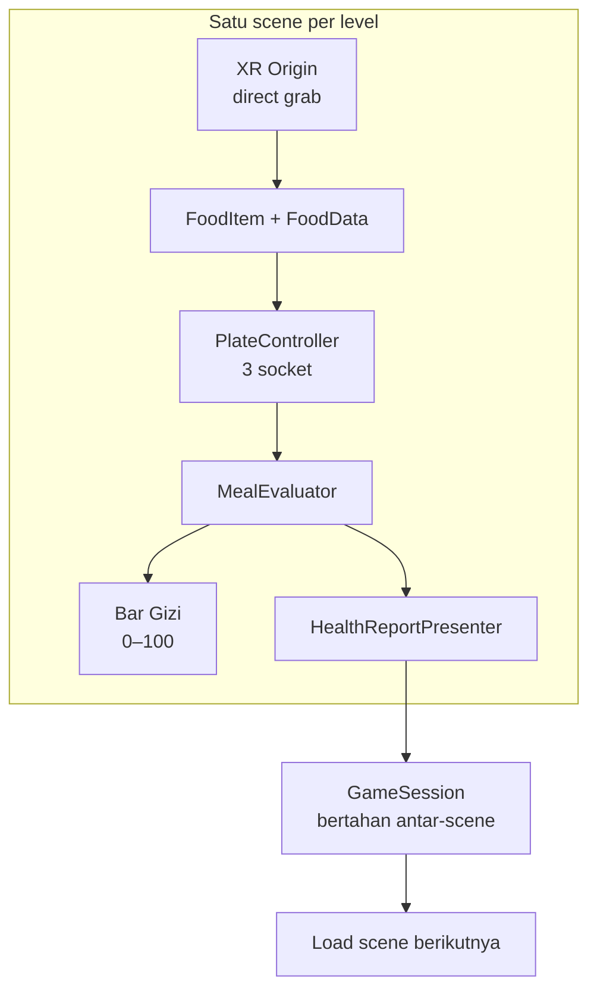
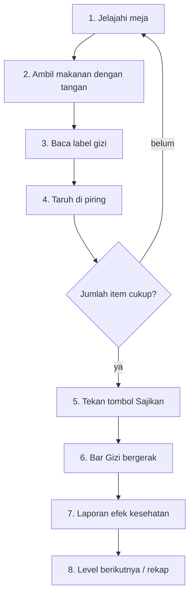
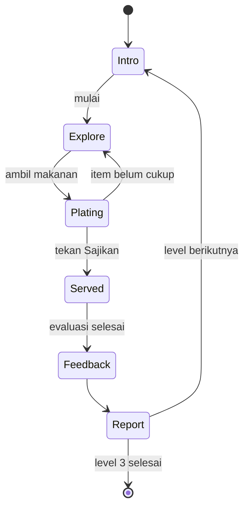

# NutriPick VR — Rencana Interaksi & Umpan Balik Gizi

<Callout type="warn">
  **Superseded:** This note reflects the earlier XR hand-grab plan. The active specification and plan are in `specs/001-nutripick-vr-game/` and use a Rexus gamepad with a bazaar Level 3.
</Callout>

Kamu memegang lapisan yang membuat pilihan terasa: bagaimana pemain mengambil makanan, bagaimana piring membaca pilihan itu, dan bagaimana **Bar Gizi** menjelaskan akibatnya. Plan ini sudah disesuaikan dengan jawaban grill dan disimpan sebagai catatan kerja di Obsidian.

<Callout type="decision">
  **Keputusan yang dikunci:** 3 level, 1 piring per level, 3–4 item, **satu bar 0–100**, direct grab hanya, XR Device Simulator dulu, dan tidak ada tenggat tanggal. Fokus pertama adalah Level 1 end-to-end.
</Callout>

<Stat>
- Model makanan: 10 (note) -- FBX siap, belum jadi prefab interaktif
- Environment kuliner: 2 (warn) -- warteg & Padang; level 3 TBD
- XR Origin di scene: 0 (risk) -- PlayerRig masih kosong
- Compile blocker: 1+ (risk) -- RexusInputProbe.cs
</Stat>

## Bentuk sistem



Tidak ada Boot scene. Tiap level punya XR Origin sendiri; `GameSession` dibuat otomatis dan bertahan dengan `DontDestroyOnLoad`. Ini lebih sederhana untuk dikerjakan manual dan tetap aman untuk kerja kelompok karena satu scene satu pemilik.

## Tiga level

| Level | Konteks | Fokus belajar | Mekanik | Contoh isi meja |
|-------|---------|---------------|---------|-----------------|
| 1 | Warteg, sarapan | menyusun piring dasar | grab + socket, 3 item | nasi, telur, tempe, brokoli, pisang, mie, kerupuk |
| 2 | RM Padang, makan siang | porsi, lemak, natrium | 3 item, label gizi | rendang, ayam goreng, sayur singkong, telur, brokoli, kerupuk |
| 3 | TBD — kandidat rumah | kebiasaan & minuman manis | 4 item + minuman | mie, burger, telur, tempe, brokoli, pisang, air/teh |

Target sesi **8–12 menit**. Level 3 belum dikunci; kerjakan setelah Level 1 dan 2 stabil. Tidak ada fail state: pilihan apa pun boleh, konsekuensinya muncul di laporan.

## Core loop



## Bar Gizi

Satu bar horizontal 0–100. Angka dan warna cukup; tidak perlu jarum atau pips.

| Rentang | Warna | Label | Arti |
|---------|-------|-------|------|
| 0–39 | merah | Perlu perbaikan | minim sayur/protein, tinggi gula/natrium |
| 40–69 | kuning | Cukup | ada dasar, belum seimbang |
| 70–100 | hijau | Seimbang | komposisi dan serat baik |

- **Preview** saat item masuk atau keluar piring: `PlateChanged` → `MealEvaluator` → bar bergerak.
- **Final** saat `Sajikan`: animasi 1,2 detik, lalu laporan muncul.
- Angka 0–100 ditampilkan di ujung bar.
- Pemain tidak melihat rumus; mereka melihat **2 kekuatan + 1 perbaikan** di laporan.

<Callout type="note">
  Tidak ada makanan yang “dilarang”. Yang dinilai adalah kombinasi, porsi, dan frekuensi. Ini penting agar game mengedukasi, bukan menghakimi.
</Callout>

## Interaksi pemain

| Momen | Aksi pemain | Respons sistem | Umpan balik |
|-------|-------------|----------------|-------------|
| Hover | controller menyentuh collider | label ringkas muncul | nama, kalori, serat |
| Ambil | grip | makanan menempel | haptic 0,2 detik + SFX |
| Periksa | masih dipegang | label gizi lengkap | protein, serat, gula tambahan, natrium |
| Taruh | lepas di atas piring | snap ke socket kosong | piring menyala + bar preview |
| Ambil lagi | grip dari piring | item keluar, skor dihitung ulang | bar turun/naik |
| Sajikan | tekan tombol 3D | piring terkunci, evaluasi final | bar animasi + haptic |
| Lanjut | tekan tombol di laporan | scene berikutnya dimuat | fade + suara |

<Compare>
## Direct grab only (pick)
- pro: paling fisik dan jelas untuk makanan
- pro: tidak perlu ray, lebih sedikit bug hover
- con: semua makanan harus dalam jangkauan 0,3–0,8 m

## Direct + ray
- pro: makanan jauh tetap terjangkau
- con: menambah kompleksitas dan mengurangi rasa “memegang”
</Compare>

<Callout type="warn">
  **Direct grab only** berarti tidak ada ray interactor. Matikan `Enable Far Casting` pada NearFarInteractor kiri dan kanan. Semua makanan diletakkan di meja, bukan di rak jauh.
</Callout>

## Data & evaluasi

```csharp title="Assets/Scripts/Nutrition/FoodData.cs"
[CreateAssetMenu(menuName = "NutriPick/Food Data")]
public class FoodData : ScriptableObject
{
    public string id;
    public string displayName;
    [TextArea] public string description;
    public FoodCategory category;
    public ProcessingLevel processing;
    public int calories;
    public float protein, carbs, fat, fiber, addedSugar, sodium;
    public string portionLabel;
    public Sprite icon;
    public GameObject prefab;
}
```

| Faktor | Arah | Bobot awal | Sumber |
|--------|------|------------|--------|
| Keseimbangan piring | + | 50% | kategori makanan |
| Serat | + | 30% | gram serat |
| Protein | + | 20% | gram protein |
| Gula tambahan | − | 15% | gram gula tambahan |
| Natrium | − | 10% | mg natrium |
| Tingkat proses | − | 5% | label proses |

```math
\text{positif} = 0.50B + 0.30F + 0.20P
```

```math
\text{penalti} = 0.15G + 0.10N + 0.05U
```

```math
\text{skor} = \text{clamp01}(\text{positif} - \text{penalti}) \times 100
```

Bobot ini **hipotesis awal**, bukan angka final. Semua ada di `NutritionRules` ScriptableObject supaya bisa dikalibrasi tanpa mengubah kode. `MealEvaluator` adalah fungsi murni yang bisa dites.



## Efek kesehatan di akhir

Tiga dimensi, bukan satu angka besar. Tujuannya agar pemain melihat trade-off: makanan yang mengenyangkan belum tentu membuat fokus stabil.

| Dimensi | Sinyal utama | Contoh kalimat |
|---------|--------------|----------------|
| Energi | karbo, porsi, gula | “Energimu lebih stabil sampai sore.” |
| Fokus | protein, serat, gula | “Konsentrasi lebih stabil di jam belajar.” |
| Kesehatan jangka panjang | serat, natrium, lemak jenuh, ultra-proses | “Kebiasaan ini lebih ramah untuk tekanan darah.” |

Setiap laporan level menampilkan **2 kekuatan + 1 perbaikan**. Rekap akhir merangkum tiga level dan memberi satu langkah berikutnya. Bahasa selalu probabilistik, bukan diagnosis.

<Callout type="warn">
  Ini game edukasi untuk project mata kuliah, bukan alat medis. Gunakan sumber publik seperti Panganku/TKPI, Kemenkes, dan WHO; tampilkan disclaimer; jangan membuat klaim medis. Review ahli gizi tidak diwajibkan untuk scope ini.
</Callout>

## Rencana kerja

<Phase title="M0 — Audit & XR Simulator" status="planned">
  Rapikan fondasi sebelum fitur. Ini juga titik di mana kerja kelompok mulai dipisahkan.

  - [ ] Perbaiki atau hapus `RexusInputProbe.cs` yang membuat compile gagal
  - [ ] Buat scene `Level01_Warteg`, jangan pakai `MainVR`
  - [ ] Tambah `XR Origin (XR Rig).prefab` + `XR Interaction Simulator.prefab`
  - [ ] Matikan `Enable Far Casting` di kedua controller
  - [ ] Tes grab/lepas kubus di Play Mode

  **Selesai bila:** project compile, simulator jalan, dan kubus bisa di-grab.
</Phase>

<Phase title="M1 — Data & Scoring" status="planned">
  Bangun otak penilaian sebelum visual.

  - [ ] `FoodData`, `NutritionRules`, `MealResult`, `MealEvaluator`
  - [ ] 3 aset contoh: nasi, telur, brokoli
  - [ ] Kalibrasi: piring seimbang > piring gorengan
  - [ ] Validator data opsional

  **Selesai bila:** evaluator memberi skor masuk akal untuk 3 piring contoh.
</Phase>

<Phase title="M2 — Interaction Core" status="planned">
  Bangun loop dengan primitif dulu: kubus makanan, piring, dan bar.

  - [ ] `FoodItem`, `FoodHoverInfo`, `PlateSlot`, `PlateController`
  - [ ] `ServeButton`, `VRButton`
  - [ ] Prefab makanan + prefab piring 3 socket
  - [ ] Preview bar saat item masuk/keluar
  - [ ] Tombol Sajikan dan tombol Next

  **Selesai bila:** satu piring berisi 3 primitif bisa disajikan dan bar bergerak.
</Phase>

<Phase title="M3 — UI & Flow" status="planned">
  Pisahkan logika dari tampilan supaya tim UI bisa bekerja paralel.

  - [ ] `NutritionBar` 0–100 + gradient
  - [ ] `HealthReportPresenter` 3 dimensi
  - [ ] `LevelFlowController` + `GameSession`
  - [ ] Laporan muncul setelah 1,3 detik
  - [ ] Level 1 → Level 2 tanpa reload manual

  **Selesai bila:** alur level lengkap dan skor tersimpan.
</Phase>

<Phase title="M4 — Level 1 Vertical Slice" status="planned">
  Konten nyata pertama. Jangan sentuh Level 2 sebelum ini selesai.

  - [ ] Isi `FoodData` untuk 7 makanan Warteg
  - [ ] Susun meja dari prefab tim
  - [ ] 3 item target
  - [ ] Playtest satu sesi penuh
  - [ ] Perbaiki bug yang menghalangi

  **Selesai bila:** Level 1 bisa dimainkan dari intro sampai laporan.
</Phase>

<Phase title="M5 — Level 2" status="planned">
  Ulangi pola yang sama dengan konten Padang.

  - [ ] 6 makanan Padang + data gizi
  - [ ] 3 item target
  - [ ] Tidak ada script baru jika bisa
  - [ ] Uji transisi Level 1 → 2

  **Selesai bila:** Level 2 selesai tanpa perubahan arsitektur.
</Phase>

<Phase title="M6 — Level 3 + Rekap" status="planned">
  Tentukan tema, lalu tutup loop.

  - [ ] Putuskan tema Level 3
  - [ ] 4 item + minuman (jika dipakai)
  - [ ] `isFinalLevel` aktif
  - [ ] Rekap 3 level + disclaimer

  **Selesai bila:** tiga level selesai dan rekap akhir muncul.
</Phase>

<Phase title="M7 — Polish & Demo" status="planned">
  Baru setelah konten utuh.

  - [ ] Haptic/SFX/particle feedback
  - [ ] UI rapi dan terbaca
  - [ ] Uji 5 pengguna
  - [ ] Build Android/Windows saat device tersedia
  - [ ] Skrip demo 3 menit

  **Selesai bila:** demo bisa dijalankan tanpa intervensi teknis.
</Phase>

## File yang diusulkan

<FileTree>
- add Assets/Scripts/Nutrition/FoodData.cs -- kontrak data makanan
- add Assets/Scripts/Nutrition/NutritionRules.cs -- bobot yang bisa dikalibrasi
- add Assets/Scripts/Nutrition/MealResult.cs
- add Assets/Scripts/Nutrition/MealEvaluator.cs -- fungsi murni, mudah dites
- add Assets/Scripts/Interaction/FoodItem.cs -- jembatan XRGrabInteractable ke FoodData
- add Assets/Scripts/Interaction/FoodHoverInfo.cs
- add Assets/Scripts/Interaction/PlateSlot.cs
- add Assets/Scripts/Interaction/PlateController.cs
- add Assets/Scripts/Interaction/ServeButton.cs
- add Assets/Scripts/Interaction/VRButton.cs
- add Assets/Scripts/UI/NutritionBar.cs
- add Assets/Scripts/UI/HealthReportPresenter.cs
- add Assets/Scripts/Flow/LevelFlowController.cs
- add Assets/Scripts/Flow/GameSession.cs
- add Assets/Editor/FoodDataValidator.cs -- cek id dan nilai gizi
- add Assets/Tests/EditMode/MealEvaluatorTests.cs -- opsional
- add Assets/Scenes/Level01_Warteg.unity
- add Assets/Scenes/Level02_Padang.unity
- add Assets/Scenes/Level03_Rumah.unity
- add Assets/Prefabs/Plate.prefab
- add Assets/Prefabs/FoodTemplate.prefab -- collider + XRGrabInteractable
- modify Assets/Scripts/RexusInputProbe.cs -- perbaiki compile error atau hapus
- delete Assets/Scenes/VRButton.cs -- ganti dengan VRButton baru di Interaction
- modify Assets/Scenes/MainVR.unity -- jadikan sandbox, bukan level final
</FileTree>

<Callout type="tip">
  Source code lengkap, langkah setup, dan checklist ada di Obsidian: `Mata Kuliah Semester 5/Realitas Tertambah dan Realitas Maya/NutriPick VR/`. Kamu menulis script sendiri di Unity; catatan hanya blueprint.
</Callout>

## Batas kerja kelompok

| Area | Pemilik | Serah-terima |
|------|---------|--------------|
| Interaksi & sistem gizi | Kamu | prefab, ScriptableObject, event, level flow |
| Environment 3 level | Tim environment | satu scene per level; XR Origin bisa dipasang sendiri |
| Model makanan & prop | Tim 3D | FBX/prefab, collider, pivot di dasar, skala 1 unit = 1 m |
| UI visual | Tim UI | prefab canvas; logic tetap di sistem |
| Audio & haptics | Tim audio | clip per event: hover, grab, place, serve |
| Konten & level design | Tim + kamu | daftar makanan, target porsi, teks edukasi |

<Callout type="tip">
  Aturan kolaborasi: satu scene per level, prefab untuk semua objek interaktif, dan `MainVR.unity` hanya untuk eksperimen. Commit `.meta`, aktifkan LFS untuk FBX/tekstur/audio, dan pakai UnityYAMLMerge untuk scene/prefab.
</Callout>

## Risiko

<Callout type="risk">
  **Akurasi gizi.** Skor bisa disalahartikan sebagai nasihat medis. Mitigasi: rujuk Panganku/TKPI, tampilkan disclaimer, dan hindari label “sehat/buruk” untuk satu makanan.
</Callout>

<Callout type="risk">
  **Scope tiga level.** Tiga environment + 10 makanan + UI bisa meledak. Mitigasi: Level 1 end-to-end dulu; Level 2 dan 3 memakai sistem yang sama.
</Callout>

<Callout type="risk">
  **Belum ada headset.** Simulator cukup untuk mekanik, tetapi performa dan kenyamanan belum terukur. Mitigasi: jaga budget ringan, uji device begitu tersedia.
</Callout>

<Callout type="warn">
  **Temuan teknis saat ini:** `MainVR.unity` belum punya XR Origin atau `TrackedPoseDriver`, dan `RexusInputProbe.cs` bukan C# yang valid. Keduanya harus dibereskan di M0.
</Callout>

## Definition of done

<Checklist title="Selesai bila">
- [ ] Semua makanan punya `FoodData` valid: id unik, nilai gizi, prefab
- [ ] Direct grab, hover, socket, dan remove berfungsi di kiri & kanan
- [ ] Bar preview dan final konsisten; piring kosong tidak bisa disajikan
- [ ] Unit test evaluator lolos (opsional): seimbang > gorengan, clamp
- [ ] Tiga level bisa dimainkan berurutan
- [ ] Laporan akhir menampilkan 3 dimensi + alasan + disclaimer
- [ ] Stabil di XR Device Simulator
- [ ] 5 pengguna bisa menjelaskan kenapa bar bergerak
- [ ] Build Android/Windows sukses saat device tersedia
- [ ] Teks Indonesia terbaca; subtitle/opsi audio tersedia
</Checklist>

## Yang masih terbuka

<Questions title="Keputusan yang belum dikunci">
- Tema final Level 3 apa?
  - Rumah / meja makan (Rekomendasi)
  - Kantin kampus
  - Minimarket
  - Tetap di RM Padang
- Apakah minuman masuk penilaian Level 3?
  - Ya, satu minuman wajib (Rekomendasi)
  - Ya, opsional
  - Tidak, makanan saja
- Siapa pemilik environment, UI visual, dan audio?
  - Jawab bebas: nama pemilik
- Perlu kuis singkat sebelum/sesudah main?
  - Tidak dulu, fokus demo (Rekomendasi)
  - Ya, 3 pertanyaan
  - Ya, 5 pertanyaan
</Questions>
