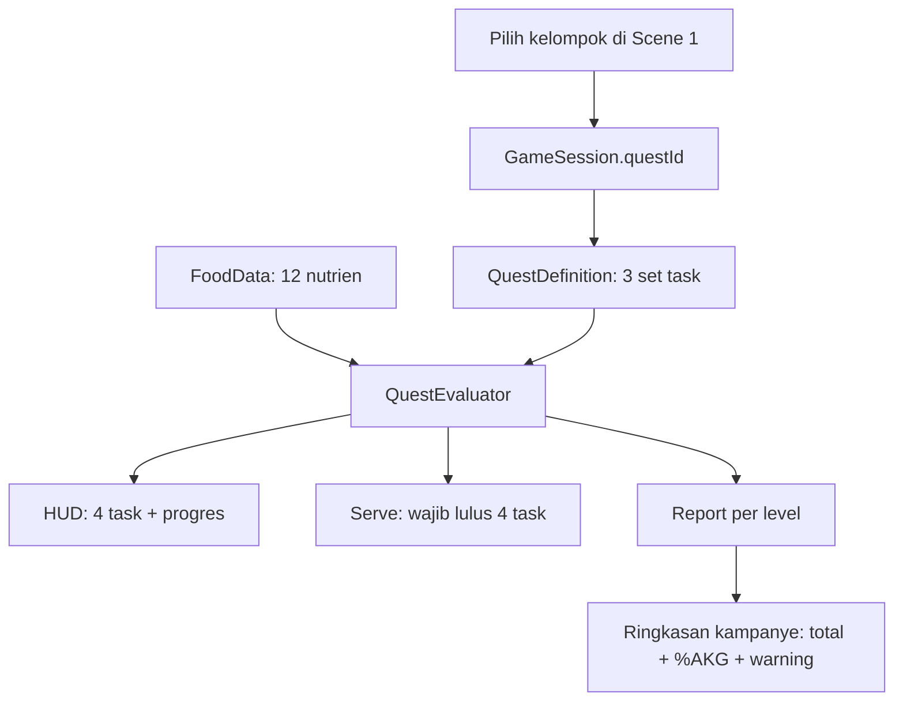

# Quest Kelompok & Gizi NutriPick

Satu kelompok dipilih sekali di Scene 1, lalu tiap level (sarapan/siang/malam) memberi 4 task: 2 komposisi dan 2 ambang gizi. Serve terkunci sampai keempat task lulus. Report menampilkan gizi piring per level, dan ringkasan kampanye menampilkan total 3 level dengan %AKG serta peringatan natrium/gula/lemak.

## Kelompok & AKG

Band umur mengikuti AKG Indonesia 2019; nilai gizi permainan diskalakan per porsi.

| Kelompok | Band | Energi | Protein | Serat | Natrium maks | Gula maks | Lemak maks |
|---|---|---|---|---|---|---|---|
| Anak-anak | 7-9 | 1850 kkal | 45 g | 26 g | 1200 mg | 25 g | 60 g |
| Dewasa | 19-29 | 2250 kkal | 60 g | 30 g | 1500 mg | 50 g | 65 g |
| Lansia | 60-69 | 1700 kkal | 60 g | 25 g | 1200 mg | 25 g | 50 g |

| Kelompok | Vit A | Vit C | Vit D | Kalsium | Besi |
|---|---|---|---|---|---|
| Anak-anak | 600 µg | 45 mg | 15 µg | 1000 mg | 10 mg |
| Dewasa | 600 µg | 75 mg | 15 µg | 1000 mg | 12 mg |
| Lansia | 600 µg | 75 mg | 20 µg | 1000 mg | 9 mg |

## Task per level

Komposisi sama untuk semua kelompok; ambang gizi yang membedakan. Semua kelompok setara tingkat kesulitannya.

| Level | Komposisi wajib |
|---|---|
| 1 Sarapan | 1 protein + 1 buah |
| 2 Makan siang | 1 protein + 1 sayur |
| 3 Makan malam | 1 protein + 1 sayur |

| Kelompok | Level | Ambang 1 | Ambang 2 |
|---|---|---|---|
| Anak-anak | 1 | Protein ≥ 15 g | Kalsium ≥ 330 mg |
| Anak-anak | 2 | Vit A ≥ 200 µg | Serat ≥ 8 g |
| Anak-anak | 3 | Kalsium ≥ 330 mg | Vit C ≥ 15 mg |
| Dewasa | 1 | Protein ≥ 20 g | Serat ≥ 10 g |
| Dewasa | 2 | Vit C ≥ 25 mg | Besi ≥ 4 mg |
| Dewasa | 3 | Protein ≥ 20 g | Serat ≥ 10 g |
| Lansia | 1 | Protein ≥ 20 g | Kalsium ≥ 350 mg |
| Lansia | 2 | Vit D ≥ 7 µg | Serat ≥ 8 g |
| Lansia | 3 | Protein ≥ 20 g | Kalsium ≥ 350 mg |

<Callout type="warn">
Batas maksimum natrium, gula, dan lemak **tidak** mengunci serve. Nilainya dibandingkan dengan 1/3 AKG per level dan 100% AKG di ringkasan akhir, lalu ditandai jika melebihi.
</Callout>

## Report

| Layar | Isi |
|---|---|
| Setelah serve | Status 4 task (semua lulus) + 7 nilai: energi, protein, karbohidrat, lemak, serat, natrium, gula |
| Ringkasan kampanye | Total 3 level + 12 nilai termasuk vit A/C/D, kalsium, besi; %AKG kelompok; warning jika natrium/gula/lemak > 100% AKG |

<Phase title="Data gizi 18 makanan" status="planned">
Tambah 5 nutrien mikro ke `FoodData`, tampilkan di info card, dan isi 12 makanan lama plus 6 makanan baru.

- `vitaminA` (µg), `vitaminC` (mg), `vitaminD` (µg), `calcium` (mg), `iron` (mg)
- Info card menampilkan 12 nilai absolut; kartu makanan tetap ringkas
- Validasi angka non-negatif di `FoodData.IsValid`

<FileTree>
- modify `Assets/Scripts/Nutrition/FoodData.cs` -- 5 field mikro baru
- modify `Assets/Scripts/UI/FoodInfoCardPresenter.cs` -- 12 baris gizi
- modify `Assets/Scripts/UI/FoodCardModel.cs` -- model info card
- add `Assets/Editor/NutritionDataPatcher.cs` -- isi nilai 18 aset
</FileTree>
</Phase>

<Phase title="Quest definition & evaluator" status="planned">
`QuestDefinition` per kelompok menyimpan 3 set task. `QuestEvaluator` menggantikan aturan 4 kategori lama.

- Task: `CategoryRequirement` dan `NutrientMinimum`
- Evaluator mengembalikan lulus/gagal per task, total gizi, dan daftar warning
- `PlateController.CanServe` memakai evaluator, bukan `MealRequirement`

<FileTree>
- add `Assets/Scripts/Quests/QuestDefinition.cs` -- 3 level task + AKG
- add `Assets/Scripts/Quests/QuestTask.cs` -- tipe task
- add `Assets/Scripts/Quests/QuestEvaluator.cs` -- penilaian piring
- add `Assets/Scripts/Quests/AkgReference.cs` -- tabel AKG
- delete `Assets/Scripts/Nutrition/MealRequirement.cs` -- digantikan evaluator
- modify `Assets/Scripts/Interaction/PlateController.cs` -- serve per quest
</FileTree>
</Phase>

<Phase title="UI pilih quest, HUD, report" status="planned">
Tiga layar baru di FigmaHUD: kartu pilih kelompok, checklist 4 task, dan ringkasan kampanye. Skor 0-100 dan panel gorengan dihapus.

- `QuestSelectPresenter`: 3 kartu, fokus controller, muncul setelah CARA BERMAIN
- HUD bawah: 4 task dengan progres, misal `PROTEIN 18/20 g [ ]`
- `FinalResultPresenter`: status task + tabel gizi 7 baris
- `CampaignSummaryPresenter`: total 12 nilai, %AKG, warning
- BANTUAN menampilkan kelompok aktif dan 4 task level ini

<FileTree>
- add `Assets/Scripts/UI/QuestSelectPresenter.cs` -- pilih kelompok
- add `Assets/Scripts/UI/CampaignSummaryPresenter.cs` -- ringkasan 3 level
- modify `Assets/Scripts/UI/MealStatusBarPresenter.cs` -- checklist 4 task
- modify `Assets/Scripts/UI/FinalResultPresenter.cs` -- status task + tabel
- modify `Assets/Scripts/UI/StartGuidePresenter.cs` -- ringkasan quest di BANTUAN
- modify `Assets/Editor/FigmaHudBuilder.cs` -- prefab baru
- delete `Assets/Scripts/UI/FriedWarningPresenter.cs` -- panel gorengan dihapus
- delete `Assets/Scripts/UI/HealthReportPresenter.cs` -- report lama tak terpakai
</FileTree>
</Phase>

<Phase title="Integrasi flow & scene" status="planned">
`GameSession` menyimpan kelompok pilihan. `LevelFlowController` mengunci serve sampai 4 task lulus, lalu menampilkan report level dan ringkasan akhir setelah Level 3.

- Level 1 sarapan, Level 2 makan siang, Level 3 makan malam
- Scene 1: 8 piring = 4 makanan lama + 4 baru
- Scene 2: 7 lauk = 4 lama + 3 baru
- Scene 3: 30 stall memakai seluruh 18 makanan

<FileTree>
- modify `Assets/Scripts/Flow/GameSession.cs` -- questId + hasil per level
- modify `Assets/Scripts/Flow/LevelFlowController.cs` -- gating, report, summary
- modify `Assets/Editor/Scene1HomeBuilder.cs` -- menu 8 piring
- modify `Assets/Editor/Scene2WartegBuilder.cs` -- menu 7 lauk
- modify `Assets/Editor/Scene3BazaarBuilder.cs` -- 18 makanan di 30 stall
- modify `Assets/Editor/NutriPickSceneValidator.cs` -- validasi quest
</FileTree>
</Phase>

<Phase title="6 makanan baru + dokumentasi Blender" status="planned">
Referensi gambar dari Anda ditaruh di `References/Quest_Foods/` (satu folder datar). Setelah itu aset dimodelkan low-poly dan didokumentasikan 3 gambar per makanan.

| Makanan | Kategori | Nutrisi kunci |
|---|---|---|
| Ikan cakalang | Protein | Vit D, kalsium, protein |
| Jeruk | Buah | Vit C, serat |
| Wortel | Sayur | Vit A, serat |
| Bayam | Sayur | Besi, kalsium, vit A |
| Tahu | Protein | Kalsium, protein |
| Ubi jalar | Karbohidrat | Vit A, serat |

- Skrip Blender baru mengekspor FBX ke `Assets/Models/Food/Home/`
- Prefab, ikon, dan `FoodData` untuk 6 makanan
- Dokumentasi: `<makanan>_1_referensi`, `_2_modelling`, `_3_shading` di `docs/asset/quest_foods/`

<FileTree>
- add `Blender/Food/scripts/build_quest_foods.py` -- 6 model low-poly
- add `Assets/Models/Food/Home/Food_ikan_cakalang.fbx` -- dan 5 lainnya
- add `Assets/Prefabs/Food/ikan_cakalang.prefab` -- dan 5 lainnya
- add `Assets/ScriptableObjects/Food/FD_ikan_cakalang.asset` -- dan 5 lainnya
- add `docs/asset/quest_foods/` -- 18 gambar dokumentasi
- add `References/Quest_Foods/` -- gambar referensi dari Anda
</FileTree>
</Phase>

<Phase title="Test, QA, catatan" status="planned">
Perbarui seluruh test yang masih memakai skor dan aturan 4 kategori, lalu tulis catatan Obsidian.

- EditMode: tabel AKG, evaluator task, validasi FoodData
- PlayMode: pilih quest, HUD progres, serve terkunci, report, ringkasan, BANTUAN
- Scene validator: referensi quest dan 18 makanan
- Catatan: `docs/plans/quest-system.md` + visual plan MDX/HTML

<Checklist title="Selesai bila">
- [ ] 3 kelompok bisa dipilih dan tersimpan sampai Level 3
- [ ] Serve hanya aktif saat 2 komposisi + 2 ambang gizi lulus
- [ ] HUD menampilkan progres keempat task
- [ ] Report level menampilkan 7 nilai gizi
- [ ] Ringkasan akhir menampilkan 12 nilai + %AKG + warning
- [ ] 18 makanan punya data gizi lengkap
- [ ] 6 aset baru + 18 gambar dokumentasi tersedia
- [ ] EditMode, PlayMode, dan validator lulus
</Checklist>
</Phase>

<Callout type="risk">
Enam aset baru butuh gambar referensi dari Anda. Kode, data, dan UI bisa selesai lebih dulu memakai 12 makanan lama, lalu aset baru masuk tanpa mengubah struktur quest.
</Callout>

<Callout type="decision">
Skor 0-100 diganti status task, dan panel peringatan gorengan dihapus. Lemak serta natrium tetap dihitung dan ditandai di report.
</Callout>

<Questions title="Perlu konfirmasi">
- Apakah angka target pada tabel task sudah pas, atau ada yang ingin dinaikkan/diturunkan?
  - Sudah pas
  - Terlalu ketat, turunkan sekitar 20%
  - Terlalu longgar, naikkan sekitar 20%
</Questions>
