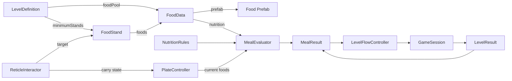
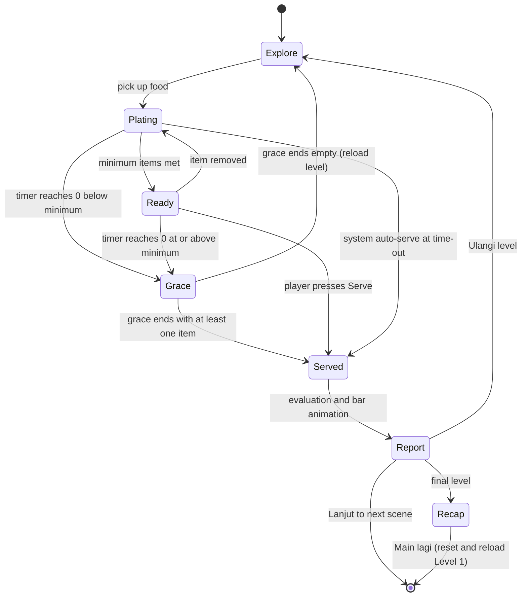
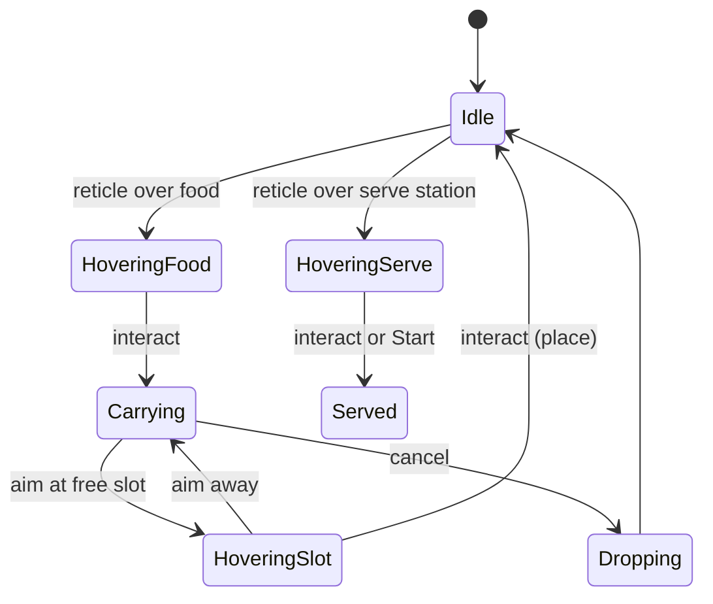
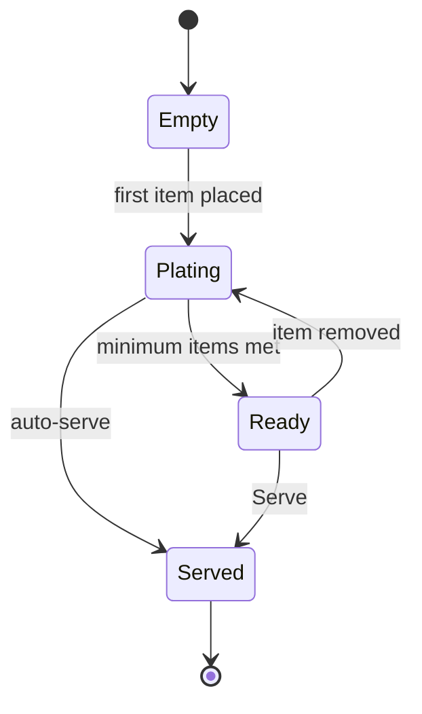

# Data Model: NutriPick VR

**Feature**: `001-nutripick-vr-game` | **Date**: 2026-11-16

The data model separates authored content (ScriptableObjects) from runtime state (plain C# and scene components). Scoring and classification are pure functions with no scene references.

## Entity Relationship Overview



## Enumerations

### FoodCompositionCategory (flags)

| Value | Bit | Meaning |
|-------|-----|---------|
| None | 0 | No category assigned; invalid |
| Vegetable | 1 | Vegetable dish or side |
| Protein | 2 | Egg, tempeh, meat, fish, legume |
| Carbohydrate | 4 | Rice, noodles, bread, staple |
| Fruit | 8 | Fresh fruit |
| Drink | 16 | Water, tea, or other drink |
| Snack | 32 | Crackers, chips, or similar |

`Snack` is a classification category, not a variety category. It does not earn a composition bonus.

### ProcessingLevel

| Value | Meaning | Processing penalty |
|-------|---------|--------------------|
| Minimal | Whole or minimally processed food | 0.0 |
| Processed | Cooked, fermented, or traditionally processed dish | 0.5 |
| UltraProcessed | Industrially formulated product | 1.0 |

### HealthyOverride

| Value | Meaning |
|-------|---------|
| None | Use the classifier rules |
| ForceHealthy | Author override to Healthy |
| ForceLessHealthy | Author override to LessHealthy |

### FoodHealthLabel

| Value | UI label | UI color |
|-------|----------|----------|
| Healthy | "Sehat" | Green |
| LessHealthy | "Kurang sehat" | Amber |

### ScoreBand

| Value | Range | UI label | UI color |
|-------|-------|----------|----------|
| Neutral | Empty plate only | "Belum dinilai" | Gray |
| NeedsImprovement | 0–39 | "Perlu perbaikan" | Red |
| Adequate | 40–69 | "Cukup" | Yellow |
| Balanced | 70–100 | "Seimbang" | Green |

### DimensionRating

| Value | Meaning |
|-------|---------|
| Rendah | Low |
| Cukup | Adequate |
| Baik | Good |
| Berlebih | Excessive |
| PerluPerhatian | Needs attention |

### CarryState

| Value | Meaning |
|-------|---------|
| Idle | Empty-handed, reticle free |
| HoveringFood | Reticle over a food item |
| Carrying | Holding a food item in front of the camera |
| HoveringSlot | Carrying and aiming at a free plate slot |
| HoveringServe | Reticle over the serve station |
| Dropping | Releasing the carried item |

## Entity: FoodData (ScriptableObject)

**Menu**: `NutriPick/Food Data`

| Field | Type | Validation | Purpose |
|-------|------|------------|---------|
| `id` | string | Non-empty, unique, lowercase snake_case | Stable identifier for saves, tests, and reports |
| `displayName` | string | Non-empty, Indonesian | Name shown on the card |
| `description` | string | 1–2 supportive sentences | Educational explanation |
| `composition` | FoodCompositionCategory flags | At least one flag; not None | Composition and variety tracking |
| `processing` | ProcessingLevel | Valid enum | Processing penalty |
| `isFried` | bool | — | Fried penalty and classification |
| `isDrink` | bool | True only when `Drink` flag is set | Drink requirement and hydration bonus |
| `calories` | int | ≥ 0 | Energy dimension and card |
| `protein` | float (g) | ≥ 0 | Card, score, focus dimension |
| `carbs` | float (g) | ≥ 0 | Card, energy dimension |
| `fat` | float (g) | ≥ 0 | Card, long-term dimension |
| `fiber` | float (g) | ≥ 0 | Card, score, focus dimension |
| `addedSugar` | float (g) | ≥ 0 | Card, score, energy dimension |
| `sodium` | float (mg) | ≥ 0 | Card, score, long-term dimension |
| `portionLabel` | string | Non-empty, e.g. "150 g" or "1 butir" | Portion context |
| `icon` | Sprite | Optional | Future UI use; not required for the first pass |
| `prefab` | GameObject | Required; must contain `FoodItem` whose `data` matches this asset | Spawn source |
| `healthyOverride` | HealthyOverride | Valid enum | Documented cultural exception |

**Derived (not serialized)**:

- `ResolveLabel(NutritionRules rules)` → `FoodHealthLabel`
- `HealthValue(NutritionRules rules)` → float 0–1
- `HasCategory(FoodCompositionCategory category)` → bool

**Invariants**:

- `id` is unique across all FoodData assets.
- A drink has `isDrink == true` and the `Drink` flag; a non-drink has `isDrink == false`.
- `prefab` contains exactly one `FoodItem`, and that component's `data` points back to this asset.
- An override must be documented in the catalog with a one-line reason.

## Entity: NutritionRules (ScriptableObject)

**Menu**: `NutriPick/Nutrition Rules`

### Scoring weights

| Field | Default | Validation |
|-------|---------|------------|
| `itemWeight` | 0.50 | 0–1; `itemWeight + compositionWeight = 1` |
| `compositionWeight` | 0.50 | 0–1 |
| `fiberTargetGrams` | 8 | > 0 |
| `proteinTargetGrams` | 20 | > 0 |
| `sugarTargetGrams` | 15 | > 0 |
| `sodiumTargetMg` | 600 | > 0 |
| `fiberWeight` | 0.15 | ≥ 0 |
| `proteinWeight` | 0.15 | ≥ 0 |
| `sugarWeight` | 0.20 | ≥ 0 |
| `sodiumWeight` | 0.15 | ≥ 0 |
| `processingWeight` | 0.10 | ≥ 0 |
| `friedWeight` | 0.05 | ≥ 0 |
| `unsweetenedDrinkBonus` | 0.15 | ≥ 0 |
| `itemHealthMin` | 0.05 | 0–1 |
| `itemHealthMax` | 0.95 | 0–1; min < max |
| `coreWeight` | 0.70 | 0–1 |
| `varietyWeight` | 0.30 | 0–1; core + variety = 1 |
| `missingCorePenalty` | 0.15 | ≥ 0 |
| `emptyPlateValue` | 50 | 0–100 |

### Classification thresholds

| Field | Default | Meaning |
|-------|---------|---------|
| `healthySugarMax` | 10 g | Above this → LessHealthy |
| `healthySodiumMax` | 500 mg | Above this → LessHealthy |
| `healthyDrinkSugarMax` | 5 g | Above this → LessHealthy for drinks |

### Report thresholds

| Field | Default | Meaning |
|-------|---------|---------|
| `proteinStrengthMin` | 20 g | "Protein cukup" strength |
| `fiberStrengthMin` | 6 g | "Serat cukup" strength |
| `sugarStrengthMax` | 5 g | "Gula tambahan rendah" strength |
| `sodiumStrengthMax` | 600 mg | "Natrium terkendali" strength |
| `varietyStrengthMin` | 4 | "Piring beragam" strength |
| `improvementSugarMax` | 10 g | Above this → reduce sugar |
| `improvementSodiumMax` | 800 mg | Above this → reduce sodium |
| `improvementProteinMin` | 15 g | Below this → add protein |
| `improvementFiberMin` | 5 g | Below this → add fiber |
| `calorieHigh` | 800 kcal | Above this → portion note |
| `energyLow` | 400 kcal | Below this → energy low |
| `energyHigh` | 700 kcal | Above this → energy high |
| `focusProteinMin` | 20 g | Focus good threshold |
| `focusFiberMin` | 6 g | Focus good threshold |
| `focusSugarMax` | 10 g | Focus good threshold |
| `longTermFiberMin` | 6 g | Long-term good threshold |
| `longTermSodiumMax` | 600 mg | Long-term good threshold |
| `longTermUltraMax` | 1 | Long-term good threshold |
| `longTermSodiumHigh` | 1000 mg | Long-term concern threshold |
| `longTermUltraHigh` | 2 | Long-term concern threshold |
| `longTermSugarHigh` | 20 g | Long-term concern threshold |

### Score bands

| Field | Default |
|-------|---------|
| `bands` | 3 entries: 0–39 NeedsImprovement, 40–69 Adequate, 70–100 Balanced |

**Validation**: bands cover 0–100 without gaps or overlaps; labels and colors are non-empty.

## Entity: LevelDefinition (ScriptableObject)

**Menu**: `NutriPick/Level Definition`

| Field | Type | Validation | Purpose |
|-------|------|------------|---------|
| `levelId` | string | Unique, e.g. "level_01_warteg" | Stable identifier |
| `displayName` | string | Non-empty, Indonesian | Report title |
| `sceneName` | string | Must match a scene in Build Settings | Scene loading |
| `levelIndex` | int | 1–3, unique | Session order |
| `settingDescription` | string | Non-empty | Intro and report context |
| `foodPool` | FoodData[] | 6–8 entries, unique | Spawn pool |
| `minItems` | int | 3–4; ≤ foodPool length | Serve gate |
| `requiresDrink` | bool | If true, pool has ≥1 Drink | Level 3 rule |
| `minimumStands` | int | 1 for Levels 1–2; ≥3 for Level 3 | Bazaar rule |
| `timeLimitSeconds` | float | > 0; default 180 | Countdown |
| `graceSeconds` | float | > 0; default 30 | Time-out grace |
| `isFinalLevel` | bool | True only for Level 3 | Recap trigger |
| `learningFocus` | string[] | 1–3 entries | Intro and report context |

**Level defaults**:

| Level | Scene | Foods | Min items | Drink | Min stands | Final |
|-------|-------|------:|----------:|-------|-----------:|-------|
| 1 | `MainVR` | 8 | 3 | No | 1 | No |
| 2 | `Level02_Padang` | 7 | 3 | No | 1 | No |
| 3 | `Level03_Bazaar` | 8 | 4 | Yes | 4 | Yes |

**Validation rules**:

- The pool contains at least two Healthy and two LessHealthy foods.
- Every pool entry is unique.
- `sceneName` is present in `EditorBuildSettings`.
- `levelIndex` values are 1, 2, 3 with no gaps.
- `isFinalLevel` is true only for `levelIndex == 3`.
- A drink is present when `requiresDrink` is true.
- Level 3 has at least three `FoodStand` components in the scene and at least one stand that sells a drink.

## Entity: FoodStand (MonoBehaviour)

A physical counter in a level. Levels 1 and 2 use one stand; Level 3 uses four.

| Field | Type | Validation | Purpose |
|-------|------|------------|---------|
| `standId` | string | Unique within the level | Stable identifier |
| `displayName` | string | Non-empty, Indonesian | Sign and card context |
| `foods` | FoodData[] | 1–3 entries; subset of `LevelDefinition.foodPool` | What the stand sells |
| `anchors` | Transform[] | Count ≥ foods count | Food placement points |
| `approachPoint` | Transform | Optional; used for layout checks | Where the player stands |

**Methods**:

- `SpawnFoods()` instantiates each `foods[i].prefab` at `anchors[i]` and registers the spawned `FoodItem` with the level.
- `ReturnFood(FoodItem item)` returns an item to its home anchor.
- `Contains(FoodData food)` checks whether the stand sells a food.

**Validation**:

- The union of all stands' `foods` equals `LevelDefinition.foodPool`.
- No food appears on two stands in the same level.
- Each stand has at least one anchor per food.
- Level 3 has at least three stands; at least one sells a drink.

**Level 3 stand layout**:

| Stand | Foods |
|-------|-------|
| Mie & Jajanan | Fried noodles, burger |
| Lauk | Boiled egg, tempeh |
| Sayur & Buah | Broccoli, banana |
| Minuman | Water, sweet tea |

## Entity: MealResult (plain C#)

Produced by `MealEvaluator.Evaluate`. Immutable after creation.

| Field | Type | Meaning |
|-------|------|---------|
| `score` | int | 0–100; 50 only for the neutral empty state |
| `band` | ScoreBand | Derived from score |
| `bandLabel` | string | Indonesian label |
| `healthyCount` | int | Items resolved Healthy |
| `lessHealthyCount` | int | Items resolved LessHealthy |
| `itemScores` | FoodScore[] | Per-item id, label, health value |
| `averageItemHealth` | float | 0–1 |
| `compositionScore` | float | 0–1 |
| `compositionCovered` | FoodCompositionCategory | Union of categories |
| `strengths` | string[2] | Two positive statements |
| `improvement` | string | One actionable suggestion |
| `dimensions` | HealthDimensions | Energy, focus, long-term |
| `isIncomplete` | bool | True when auto-served below minimum |
| `warnings` | string[] | e.g. "Piring belum lengkap" |

**FoodScore**: `foodId`, `displayName`, `healthLabel`, `healthValue`.

## Entity: HealthDimensions (plain C#)

| Field | Type | Meaning |
|-------|------|---------|
| `energy` | DimensionAssessment | Energy rating and sentence |
| `focus` | DimensionAssessment | Focus rating and sentence |
| `longTerm` | DimensionAssessment | Long-term health rating and sentence |

**DimensionAssessment**: `rating` (DimensionRating), `label` (Indonesian), `summary` (one sentence).

## Entity: GameSession (MonoBehaviour, persistent)

| Field | Type | Meaning |
|-------|------|---------|
| `Instance` | static GameSession | Singleton access |
| `sessionActive` | bool | True after the first level begins |
| `currentLevelIndex` | int | 1–3 |
| `results` | LevelResult[3] | Latest result per level |

**LevelResult**: `levelId`, `levelIndex`, `displayName`, `score`, `band`, `MealResult`, `attemptCount`.

**API contract**:

- `EnsureExists()` creates the session object with `DontDestroyOnLoad` if none exists.
- `BeginLevel(int levelIndex)` resets the session only when `levelIndex == 1` and no session is active.
- `RecordResult(int levelIndex, MealResult result)` replaces that level's result and increments `attemptCount`.
- `GetResult(int levelIndex)` returns the latest result or null.
- `ResetSession()` clears all results and sets `sessionActive = false`.
- `AverageScore()` returns the mean of recorded scores, ignoring unrecorded levels.

## Entity: PlateController (MonoBehaviour)

| Field | Type | Meaning |
|-------|------|---------|
| `slots` | PlateSlot[] | Four snap slots |
| `minItems` | int | From LevelDefinition |
| `requiresDrink` | bool | From LevelDefinition |
| `isLocked` | bool | True after serve |
| `Foods` | IReadOnlyList<FoodData> | Current plated foods |

**Events**: `PlateChanged`, `PlateLocked`.

**Methods**: `CanServe(out string reason)`, `Lock()`, `Clear()`.

**PlateState**: `Empty`, `Plating`, `Ready`, `Served`.

## Entity: PlateSlot (MonoBehaviour)

| Field | Type | Meaning |
|-------|------|---------|
| `snapPoint` | Transform | Local position/rotation for the food |
| `trigger` | Collider | Overlap detection |
| `Current` | FoodItem | Occupied item or null |
| `IsOccupied` | bool | Derived |

**Methods**: `TryPlace(FoodItem food)`, `Remove(FoodItem food)`.

The reticle can target a slot directly; the slot highlights when the carried food can be placed.

## Entity: ReticleInteractor (MonoBehaviour)

| Field | Type | Meaning |
|-------|------|---------|
| `maxDistance` | float | 3.0 m default |
| `layerMask` | LayerMask | Food, PlateSlot, ServeStation, Environment |
| `State` | CarryState | Current interaction state |
| `TargetFood` | FoodItem | Hovered food or null |
| `TargetSlot` | PlateSlot | Hovered slot or null |
| `CarriedFood` | FoodItem | Currently carried item or null |

**Events**: `HoverChanged`, `CarryChanged`, `PromptChanged`.

**Methods**: `TryPickUp()`, `TryPlace()`, `Drop()`, `TryServe()`, `Inspect()`.

## State Transitions

### Level flow



### Interaction state



### Plate state



## Food Catalog

Approximate values per portion. These are game values, not medical advice; review against TKPI/Panganku before the demo.

### Identity and classification

| ID | Name | Composition | Processing | Fried | Drink | Portion | Label |
|----|------|-------------|------------|-------|-------|---------|-------|
| `nasi_putih` | Nasi putih | Carbohydrate | Minimal | No | No | 150 g | Sehat |
| `telur_rebus` | Telur rebus | Protein | Minimal | No | No | 1 butir (55 g) | Sehat |
| `telur_ceplok` | Telur ceplok | Protein | Processed | Yes | No | 1 butir (60 g) | Kurang sehat |
| `tempe` | Tempe | Protein | Processed | No | No | 50 g | Sehat |
| `brokoli` | Brokoli | Vegetable | Minimal | No | No | 100 g | Sehat |
| `pisang` | Pisang | Fruit | Minimal | No | No | 1 buah (118 g) | Sehat |
| `mie_goreng` | Mie goreng | Carbohydrate, Snack | UltraProcessed | Yes | No | 150 g | Kurang sehat |
| `kerupuk` | Kerupuk | Snack | UltraProcessed | Yes | No | 30 g | Kurang sehat |
| `rendang` | Rendang | Protein | Processed | No | No | 100 g | Kurang sehat |
| `ayam_goreng` | Ayam goreng | Protein | Processed | Yes | No | 100 g | Kurang sehat |
| `sayur_singkong` | Sayur singkong | Vegetable | Processed | No | No | 100 g | Sehat |
| `burger` | Burger | Protein, Carbohydrate | UltraProcessed | No | No | 1 buah (200 g) | Kurang sehat |
| `air_putih` | Air putih | Drink | Minimal | No | Yes | 250 ml | Sehat |
| `teh_manis` | Teh manis | Drink | Processed | No | Yes | 250 ml | Kurang sehat |

### Nutrition values

| ID | kcal | Protein (g) | Carbs (g) | Fat (g) | Fiber (g) | Added sugar (g) | Sodium (mg) |
|----|-----:|------------:|----------:|--------:|----------:|----------------:|------------:|
| `nasi_putih` | 195 | 4.0 | 43.0 | 0.4 | 0.6 | 0 | 2 |
| `telur_rebus` | 78 | 6.3 | 0.6 | 5.3 | 0 | 0 | 62 |
| `telur_ceplok` | 110 | 6.5 | 0.5 | 8.5 | 0 | 0 | 170 |
| `tempe` | 100 | 9.0 | 4.0 | 6.0 | 1.5 | 0 | 120 |
| `brokoli` | 34 | 2.8 | 7.0 | 0.4 | 2.6 | 0 | 33 |
| `pisang` | 105 | 1.3 | 27.0 | 0.4 | 3.1 | 0 | 1 |
| `mie_goreng` | 330 | 8.0 | 45.0 | 12.0 | 2.0 | 3.0 | 800 |
| `kerupuk` | 150 | 1.0 | 20.0 | 7.0 | 0.3 | 0 | 300 |
| `rendang` | 250 | 15.0 | 5.0 | 19.0 | 1.0 | 2.0 | 600 |
| `ayam_goreng` | 260 | 20.0 | 5.0 | 18.0 | 0.2 | 0 | 500 |
| `sayur_singkong` | 90 | 3.0 | 10.0 | 4.0 | 4.0 | 0 | 300 |
| `burger` | 450 | 20.0 | 40.0 | 25.0 | 2.0 | 8.0 | 900 |
| `air_putih` | 0 | 0 | 0 | 0 | 0 | 0 | 0 |
| `teh_manis` | 90 | 0 | 22.0 | 0 | 0 | 22.0 | 5 |

### Level pools and stands

| Level | Food IDs / stands |
|-------|-------------------|
| 1 — Warteg breakfast | One stand: `rendang`, `burger`, `telur_rebus`, `telur_ceplok`, `tempe`, `brokoli`, `pisang`, `mie_goreng` |
| 2 — Padang lunch | One stand: `rendang`, `ayam_goreng`, `telur_rebus`, `telur_ceplok`, `tempe`, `brokoli`, `burger` |
| 3 — Bazaar dinner | Mie & Jajanan: `mie_goreng`, `burger`; Lauk: `telur_rebus`, `tempe`; Sayur & Buah: `brokoli`, `pisang`; Minuman: `air_putih`, `teh_manis` |

## Derived Rules

### Classification

Evaluated in this order:

1. `ForceHealthy` → Healthy.
2. `ForceLessHealthy` → LessHealthy.
3. LessHealthy if `addedSugar > healthySugarMax` OR `sodium > healthySodiumMax` OR `processing == UltraProcessed` OR `isFried` OR (`Snack` flag without `Vegetable`/`Fruit`) OR (`isDrink` AND `addedSugar > healthyDrinkSugarMax`).
4. Otherwise Healthy.

### Item health value

```text
h = clamp(
    0.50
  + 0.15 * clamp01(fiber / fiberTargetGrams)
  + 0.15 * clamp01(protein / proteinTargetGrams)
  - 0.20 * clamp01(addedSugar / sugarTargetGrams)
  - 0.15 * clamp01(sodium / sodiumTargetMg)
  - 0.10 * processingPenalty
  - 0.05 * friedPenalty
  + 0.15 * unsweetenedDrinkBonus,
  itemHealthMin, itemHealthMax)
```

### Composition and final score

```text
coreCovered = count of {Carbohydrate, Protein, Vegetable} present
distinctCategories = count of {Vegetable, Protein, Carbohydrate, Fruit, Drink} present
composition = clamp01(
    0.70 * (coreCovered / 3)
  + 0.30 * (distinctCategories / 5)
  - 0.15 * (3 - coreCovered))
score = round(100 * clamp01(0.50 * averageItemHealth + 0.50 * composition))
```

Empty plate → 50 neutral, not a scored result.

### Strengths

Pick the first two that apply, in this order:

1. Vegetable present → "Sayur hadir di piring."
2. Protein ≥ 20 g → "Protein cukup untuk kebutuhan harian."
3. Fiber ≥ 6 g → "Serat cukup untuk pencernaan."
4. Added sugar ≤ 5 g → "Gula tambahan rendah."
5. Sodium ≤ 600 mg → "Natrium terkendali."
6. Distinct categories ≥ 4 → "Piring beragam."
7. UltraProcessed count == 0 → "Pilihan minim proses."
8. Fruit present → "Ada buah segar."

Fallbacks when fewer than two apply:

- "Kamu sudah menyusun piring sendiri."
- "Kamu bisa mengulang level untuk mencoba kombinasi lain."

### Improvement

Pick the first that applies, in this order:

1. No vegetable → "Tambahkan sayur."
2. Added sugar > 10 g → "Kurangi gula tambahan."
3. Sodium > 800 mg → "Kurangi natrium."
4. Protein < 15 g → "Tambahkan protein."
5. Fiber < 5 g → "Tambahkan serat."
6. Fried or ultra-processed present → "Kurangi gorengan atau makanan ultra-proses."
7. No carbohydrate → "Tambahkan karbohidrat."
8. No fruit and score < 70 → "Tambahkan buah."
9. Calories > 800 → "Jaga porsi makan."
10. Fallback → "Pertahankan kombinasi ini dan sesuaikan porsinya."

### Health dimensions

| Dimension | Good | Concern | Summary examples |
|-----------|------|---------|------------------|
| Energy | 400–700 kcal and sugar ≤ 10 g | < 400 kcal → Rendah; > 700 kcal or sugar > 15 g → Berlebih | "Energimu cukup stabil sampai sore." / "Porsimu ringan; tambahkan sumber energi bila kamu aktif." / "Energi cepat naik, tetapi bisa turun lagi." |
| Focus | Protein ≥ 20 g, fiber ≥ 6 g, sugar ≤ 10 g | Protein < 12 g or fiber < 3 g → Rendah | "Konsentrasi lebih stabil di jam belajar." / "Protein dan serat masih rendah untuk fokus panjang." / "Cukup, tetapi bisa lebih stabil dengan protein dan serat." |
| Long-term | Fiber ≥ 6 g, sodium ≤ 600 mg, ultra-processed ≤ 1 | Sodium > 1000 mg or ultra-processed ≥ 2 or sugar > 20 g → PerluPerhatian | "Kebiasaan ini lebih ramah untuk tekanan darah." / "Natrium dan makanan ultra-proses masih tinggi." / "Sudah ada dasar; kurangi natrium untuk jangka panjang." |

## Persistence

- No database, file save, or network.
- `GameSession` lives only for the current play session.
- Restarting the application starts cleanly at Level 1.
- Retry reloads the current scene and replaces that level's result; the previous result remains until the new one is recorded.
- Gamepad disconnect pauses the game; the plate and carried item state are preserved.
