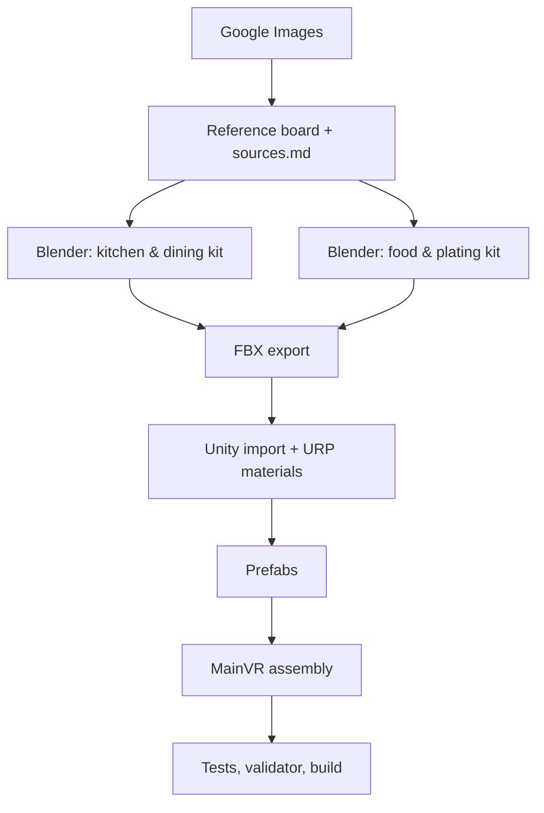
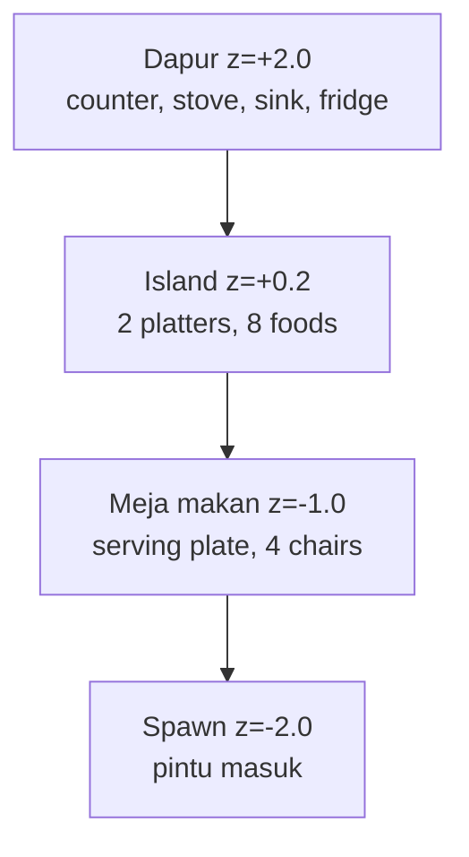

# Scene 1 — Dapur Rumah & Ruang Makan

Scene 1 (`MainVR`) diubah dari meja mockup menjadi rumah: dapur di belakang, kitchen island dengan dua platter berisi 8 makanan, dan meja makan dengan piring saji. Semua aset baru dibuat di Blender 5.2, diekspor FBX ke Unity URP, dan referensi Google disimpan di repo.

<Callout type="decision">
Disetujui 2026-11-19: gaya **Minimalis putih**, 8 model makanan dibuat ulang, Level 2/3 dibiarkan terhapus dan fokus ke Scene 1, target **desktop 1080p 60fps**.
</Callout>

<Stat>
- Makanan interaktif: 8
- Platter sajian: 2
- Aset Blender baru: ±40
- Scene yang disentuh: 1
</Stat>

## Pipeline

## Layout ruangan

<Callout type="warn">
`MainVR` saat ini hanya berisi 3 dinding + lantai, tanpa instance `FoodItem` atau `PlateSlot`. Piring prefab dan `FigmaHUD` masih ada, tetapi makanan harus di-spawn ulang dari `LD_MainVR`. Level 2/3 juga terhapus di working tree; rencana ini tidak memulihkannya tanpa persetujuan.
</Callout>

## Rencana kerja

<Phase title="Audit & baseline" status="planned">
Kunci kondisi awal sebelum mengubah scene.

- Snapshot `MainVR`, `LD_MainVR`, `ServingPlate.prefab`, dan `FigmaHUD.prefab`.
- Catat 8 food pool, tinggi meja saat ini, dan posisi `PlayerRig`.
- Simpan daftar path yang berubah agar commit hanya menyentuh Scene 1.
</Phase>

<Phase title="Reference board dari Google" status="planned">
Cari referensi visual, simpan gambar asli, dan catat sumbernya.

| Kategori | Query Google Images | Target |
|---|---|---|
| Dapur | `warm minimalist indonesian kitchen interior` | 3 gambar |
| Ruang makan | `small dining room wooden table indonesia` | 3 gambar |
| Plating | `banana leaf food platter indonesian` | 3 gambar |
| Makanan | `rendang plating`, `mie goreng plating`, `tempeh plating` | 2 per food |
| Makanan | `boiled egg plating`, `fried egg plating`, `broccoli plating` | 2 per food |
| Makanan | `banana plating`, `burger plating` | 2 per food |

- Simpan 15–20 gambar di `References/Scene1_Home/` (di luar `Assets/` agar tidak ikut build).
- Tulis `sources.md`: URL halaman, URL gambar, lisensi, tanggal akses.
- Gambar hanya dipakai sebagai referensi internal; bukan aset yang dikirim.
</Phase>

<Phase title="Blender: kit dapur & ruang makan" status="planned">
Bangun satu file sumber `Scene1_Home.blend` dengan koleksi modular.

| Zona | Aset |
|---|---|
| Shell | lantai, 4 dinding, plafon, pintu, jendela, plint |
| Dapur | kabinet bawah, kabinet atas, countertop, sink, kran, kompor, oven, range hood, kulkas, microwave, backsplash, rak |
| Dining | meja makan, 4 kursi, rug, pendant lamp, sideboard, jam dinding |
| Dekor | tanaman, stoples, talenan, dish rack, tempat sampah, mangkuk buah |

- Skala 1 unit = 1 meter; origin di dasar objek; nama `SM_` untuk mesh dan `M_` untuk material.
- Reuse material yang sudah ada: `Kayuu_ijo`, `Tiles_BaseColor`, `Painted_White_Wall_BaseColor`, `fabric_191_1_Albedo`.
- Ekspor FBX per grup: `KitchenShell`, `KitchenCabinets`, `KitchenAppliances`, `DiningSet`, `Decor`.
</Phase>

<Phase title="Blender: makanan & plating" status="planned">
Buat ulang 8 makanan dengan gaya seragam, plus alat sajinya.

| Makanan | Bentuk utama | Wadah |
|---|---|---|
| Rendang | 5–7 potong + saus | mangkuk kecil |
| Burger | bun, patty, selada, keju | piring kecil |
| Telur rebus | 2 telur, satu dibelah | piring kecil |
| Telur ceplok | putih + kuning | piring kecil |
| Tempe | 4–5 irisan | piring kecil |
| Brokoli | 5–6 floret | mangkuk kecil |
| Pisang | 2–3 buah | piring kecil |
| Mie goreng | gulungan mie + garnish | mangkuk kecil |

- Target 500–2.500 tris per makanan; total food set di bawah 15k tris.
- Pivot di dasar makanan; tinggi 8–15 cm; skala konsisten dengan `ceramic_plate.fbx`.
- Plating: 1 oval platter besar, 4 piring kecil, 4 mangkuk kecil, 1 tray bambu, 1 daun pisang.
- Ekspor `FoodSet.fbx` dan `PlatingSet.fbx`; material makanan memakai palet hangat yang sama.
</Phase>

<Phase title="Unity: import, material, prefab" status="planned">
Masukkan hasil Blender ke pipeline URP yang sudah ada.

- Import FBX dengan scale 1, `Read/Write` off, `Generate Lightmap UVs` on.
- Konversi material ke URP/Lit; tekstur 1K–2K; hindari material pink.
- Collider: box untuk kabinet/meja/dinding, convex mesh untuk makanan.
- Prefab baru: `KitchenRoom`, `KitchenIsland`, `DiningSet`, `FoodPlatter`, `ServingPlate`.
- Update prefab 8 makanan di `Assets/Prefabs/Food/` agar memakai mesh baru.
</Phase>

<Phase title="Scene 1: susun ruangan" status="planned">
Tambahkan builder sekali jalan: `NutriPick/Build Scene 1 Home`.

| Objek | Posisi | Catatan |
|---|---|---|
| `PlayerRig` | `(0, 0, -2)` | menghadap +Z |
| Dapur | `z = +2.0` | sepanjang dinding belakang |
| Island | `z = +0.2` | 2 platter, 8 anchor makanan |
| Meja makan | `z = -1.0` | 1.6 × 0.9 m, tinggi 0.75 m |
| `ServingPlate` | `(0, 0.78, -1.0)` | 4 slot, minItems 3 |
| Pintu | `z = -2.4` | di belakang spawn |

- Hapus 3 plane dinding + `TableSurfaceCollider` lama; ganti dengan room shell.
- Dua `FoodStand`: `LaukPlatter` (5 makanan) dan `KarboSayurPlatter` (3 makanan).
- Tambah collider dinding, kabinet, island, dan meja agar pemain tidak menembus.
- Lighting: directional dari jendela + 2 pendant warm; baked lightmap; reflection probe di dapur.
</Phase>

<Phase title="Gameplay & data" status="planned">
Pertahankan loop lama, ubah penyajian makanannya.

- `LD_MainVR`: `displayName` menjadi `Level 1 — Rumah`, setting `Sarapan di rumah`.
- `FoodStand.SpawnFoods()` menaruh 8 makanan di anchor platter; `FoodItem` tetap membawa data nutrisi.
- `ReticleInteractor` tetap memakai raycast 3 m; tambah jarak bila island terasa jauh.
- `FoodCardGrid`, `Status Makanan`, dan `Final Result` tidak berubah.
- Tambah test PlayMode: 8 makanan, 2 platter, plate menerima 3 makanan, Final Result muncul.
</Phase>

<Phase title="Validasi & build" status="planned">
Jalankan verifikasi yang sama seperti Scene 1 sebelumnya.

- EditMode dan PlayMode harus lulus.
- `NutriPick/Validate Scenes` harus melaporkan `Scene validation passed`.
- Build Windows 64-bit; ulangi V1–V5 di `quickstart.md`.
- Cek visual 1920×1080: makanan terlihat dari spawn, tidak ada material pink, tidak ada collider nyangkut.
</Phase>

<Phase title="Dokumentasi & commit" status="planned">
Rapikan jejak aset dan cara rebuild.

- Update `README.md`, `quickstart.md`, dan `spec.md` untuk nama level dan alur plating.
- Tulis `Assets/Models/Environment/Home/README.md` berisi daftar aset + sumber referensi.
- Commit hanya path Scene 1; biarkan perubahan material/packages yang tidak terkait.
</Phase>

## File yang berubah

<FileTree>
- add References/Scene1_Home/ -- 15–20 gambar referensi + sources.md
- add Blender/Scene1_Home/ -- .blend, script Python, dan folder exports
- add Assets/Models/Environment/Home/ -- FBX dapur, dining, dekor
- add Assets/Models/Food/Plating/ -- platter, piring, mangkuk, tray
- modify Assets/Models/Food/ -- mesh 8 makanan baru
- add Assets/Prefabs/Environment/Home/ -- prefab room, island, dining set, platter
- modify Assets/Prefabs/Food/ -- prefab makanan memakai mesh baru
- add Assets/Editor/Scene1HomeBuilder.cs -- builder scene sekali jalan
- modify Assets/Scenes/MainVR.unity -- layout dapur + ruang makan
- modify Assets/ScriptableObjects/Levels/LD_MainVR.asset -- nama dan setting rumah
- modify Assets/Editor/NutriPickSceneValidator.cs -- validasi platter dan 8 makanan
- add Assets/Tests/PlayMode/Scene1HomeTests.cs -- test layout dan plating
- modify README.md -- dokumentasi scene
- modify specs/002-mainvr-food-service/quickstart.md -- langkah QA baru
</FileTree>

## Keputusan desain

<Compare>
## 2 platter + mangkuk kecil (pick)
- pro: makanan terlihat "dikumpulkan di piring"
- pro: pengelompokan lauk vs karbo/sayur jelas
- con: butuh 8 anchor dan 2 prefab platter

## 8 piring individual
- pro: paling mudah di-raycast
- con: meja terasa penuh dan berantakan

## 1 platter besar
- pro: satu centerpiece kuat
- con: makanan berdesakan dan sulit dibidik
</Compare>

<Matrix>
| Aspek | Warm modern Indonesia (pick) | Minimalis putih | Tradisional kayu |
|--------|------------------------------|-----------------|------------------|
| Kehangatan | tinggi | rendah | tinggi |
| Cocok props lama | tinggi | sedang | sedang |
| Kontras makanan | tinggi | tinggi | sedang |
| Biaya lighting | sedang | rendah | sedang |
</Matrix>

## Pertanyaan terbuka

<Questions>
- Gaya ruangan mana yang dipakai?
  - Warm modern Indonesia (recommended)
  - Minimalis putih
  - Tradisional kayu
- Apakah 8 model makanan dibuat ulang semua?
  - Ya, semua (recommended)
  - Hanya yang paling menonjol
  - Pertahankan model lama
- Level 2/3 terhapus di working tree. Apa yang harus dilakukan?
  - Biarkan terhapus, fokus Scene 1 (recommended)
  - Pulihkan dari git
  - Hapus dari build settings
- Target performa utama?
  - Desktop 1080p 60fps (recommended)
  - VR Quest standalone
  - Keduanya
</Questions>

## Selesai bila

<Checklist title="Definition of done">
- [ ] 15–20 referensi tersimpan dan `sources.md` lengkap
- [ ] File `.blend` + FBX ada di repo
- [ ] Dapur dan ruang makan tampil di `MainVR`
- [ ] 8 makanan tersusun di 2 platter
- [ ] Piring saji menerima 3 makanan dan memunculkan Final Result
- [ ] Kartu makanan dan Status Makanan tetap berfungsi
- [ ] EditMode dan PlayMode lulus
- [ ] Build Windows sukses
- [ ] Dokumentasi diperbarui
</Checklist>

<Callout type="risk">
Risiko utama: skala/orientasi FBX Blender, material URP yang menjadi pink, collider makanan yang terlalu besar, dan bentrok dengan perubahan user yang belum di-commit. Validasi dengan kubus 1 m di Blender dan cek scene di 1920×1080 sebelum build.
</Callout>
