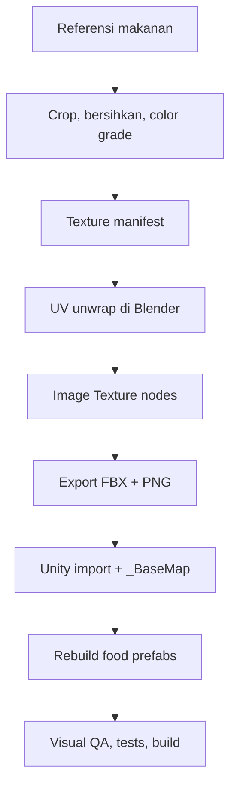

# Texture Makanan dari Referensi — Scene 1

Aset 8 makanan saat ini masih low-poly dengan material warna flat dan **belum punya UV map atau image texture**. Plan ini menambahkan albedo texture yang diambil dari crop gambar referensi di `References/Scene1_Home/foods/`, lalu membawanya lewat Blender → FBX/PNG → Unity URP.

<Stat>
- Makanan: 8
- Texture map: ±17
- Resolusi: 512–1024 px
- Mesh baru: 0
</Stat>

## Pipeline

## Kondisi saat ini

- `build_scene1_assets.py` membuat makanan dari primitive, lalu join; belum ada UV unwrap.
- Material `M_Food_*` di Blender dan Unity hanya memakai base color.
- `Scene1HomeBuilder.EnsureMaterials` membuat material makanan sebagai **URP Unlit** tanpa `_BaseMap`.
- Referensi berupa foto piring utuh; crop harus diarahkan ke permukaan makanan, bukan seluruh piring.

## Peta texture

| Makanan | Referensi utama | Texture target | UV |
|---|---|---|---|
| Rendang | `beef_rendang.jpg` | chunk, sauce | box |
| Burger | `big_mac_hamburger.jpg` | bun, patty, cheese, lettuce, tomato | cylinder + planar |
| Telur rebus | `boiled_egg_crossection.jpg` | putih, kuning | spherical |
| Telur ceplok | `02021_0912_6_fried_egg_in_the_basket.jpg` | putih, kuning | planar + spherical |
| Tempe | `fried_tempeh_in_negeri_sembilan.jpg` | permukaan irisan | box |
| Brokoli | `broccoli_and_cross_section_edit.jpg` | floret, stem | box + cylinder |
| Pisang | `banana_sitia_crete.jpg` | kulit | tube |
| Mie goreng | `mi_goreng_gm.jpg` | mie, garnish | tube |

## Tahapan

<Phase title="Audit referensi & crop manifest" status="planned">
Tentukan satu crop box per permukaan makanan; jangan memakai foto piring penuh.

- Pilih referensi terbaik per makanan; simpan nama file + lisensi.
- Tulis `texture_manifest.json`: source image, crop box, output name, wrap mode.
- Target crop: permukaan makanan yang terlihat jelas, minimal 256×256 px.
- Catat lisensi di `ATTRIBUTION.md`; untuk CC BY-SA/GFDL, siapkan atribusi.
</Phase>

<Phase title="Siapkan texture PNG" status="planned">
Buat tekstur albedo dari crop referensi dengan script yang reproducible.

- `prepare_food_textures.py`: crop, resize, color-correct, sharpen ringan.
- Output: `Assets/Textures/Food/Home/<Material>_Albedo.png`.
- Resolusi 1024 untuk makanan utama; 512 untuk bagian kecil.
- Format PNG, sRGB, tanpa alpha kecuali diperlukan.
- Texture unik memakai `Clamp`; texture permukaan berulang memakai `Repeat`.
</Phase>

<Phase title="UV unwrap & material Blender" status="planned">
Tempelkan texture ke mesh yang sudah ada tanpa mengubah bentuk.

- UV unwrap per komponen sebelum join: box projection untuk chunk/tempe, cylinder untuk bun/patty/banana, spherical untuk telur.
- Tambah `ShaderNodeTexImage` + `Mapping` ke material `M_Food_*`.
- Base Color texture; roughness tetap dari material lama.
- Simpan `.blend`; jangan bake normal map dulu.
- Cek seam dan stretching di viewport material preview.
</Phase>

<Phase title="Export & import Unity" status="planned">
Bawa FBX dan PNG ke pipeline Unity yang sudah ada.

- Export FBX dengan UV; copy PNG ke `Assets/Textures/Food/Home/`.
- Import texture: sRGB, mipmaps on, max size 1024, compression BC7/BC1.
- `Scene1HomeBuilder.EnsureMaterials`: assign `_BaseMap` dari PNG; pertahankan shader Unlit untuk makanan.
- Rebuild food prefabs lewat `CreateFoodPrefabs`; scene tetap memakai 8 makanan.
- Pastikan tidak ada material pink atau texture missing.
</Phase>

<Phase title="Visual QA" status="planned">
Bandingkan hasil Blender dan Unity.

- Render contact sheet 8 makanan di Blender.
- Capture `MainVR_Buffet` dan `MainVR_PlattersTop` di Unity.
- Cek warna, skala texture, seam, dan keterbacaan di 1920×1080.
- Cek texture memory dan draw call; target 1080p 60fps.
</Phase>

<Phase title="Test, build, dokumentasi" status="planned">
Kunci perubahan dengan verifikasi yang sama seperti Scene 1.

- EditMode test: setiap material `M_Food_*` punya `_BaseMap` non-null.
- PlayMode: 8 makanan tetap ada, platter dan plate berfungsi.
- Build Windows; ulangi V1–V5.
- Update README, quickstart, dan `ATTRIBUTION.md`.
</Phase>

## File yang berubah

<FileTree>
- add Blender/Scene1_Home/textures/food/ -- crop kerja + texture_manifest.json
- add Blender/Scene1_Home/scripts/prepare_food_textures.py -- crop/resize/color-correct
- modify Blender/Scene1_Home/scripts/build_scene1_assets.py -- UV unwrap + image texture nodes
- add Assets/Textures/Food/Home/ -- PNG final + ATTRIBUTION.md
- modify Assets/Materials/Home/ -- assign _BaseMap pada M_Food_*
- modify Assets/Editor/Scene1HomeBuilder.cs -- import setting + material texture
- modify Assets/Prefabs/Food/ -- prefab makanan memakai texture baru
- add Assets/Tests/EditMode/FoodTextureTests.cs -- validasi _BaseMap
- modify README.md -- dokumentasi texture
- modify specs/002-mainvr-food-service/quickstart.md -- QA texture
</FileTree>

## Keputusan desain

<Compare>
## Crop foto bersih (pick)
- pro: detail nyata dan sesuai referensi
- pro: cepat untuk 8 makanan
- con: perlu crop dan color-correct
- con: lisensi harus dicek

## Texture turunan stylized
- pro: lebih aman untuk lisensi
- pro: konsisten dengan gaya low-poly
- con: tidak lagi fotoreal

## Prosedural
- pro: ringan dan bebas lisensi
- con: tidak memakai gambar referensi
</Compare>

<Callout type="decision">
Pakai **satu texture per komponen** (bun, patty, putih telur, kuning telur, dan seterusnya), bukan satu atlas besar. UV menjadi lebih sederhana, texture bisa diganti per bagian, dan kesalahan mapping lebih mudah dilacak. Material makanan tetap **Unlit** agar warna foto tidak berubah oleh lighting scene.
</Callout>

<Callout type="risk">
Lisensi adalah risiko utama. Beberapa referensi berlisensi CC BY-SA atau GFDL; texture turunan harus mencantumkan atribusi dan mengikuti share-alike. Jika proyek akan dipublikasikan, ganti referensi non-permisif dengan gambar CC0 atau buat ulang texture stylized.
</Callout>

## Pertanyaan terbuka

<Questions>
- Boleh memakai crop foto langsung sebagai texture?
  - Ya, dengan atribusi (recommended)
  - Hanya texture stylized
  - Hanya referensi CC0
- Resolusi texture?
  - 1024 utama, 512 kecil (recommended)
  - Semua 512
  - Semua 1024
- Shader makanan?
  - Unlit, warna konsisten (recommended)
  - URP Lit, butuh lighting
  - Simple Lit
- Cakupan?
  - 8 makanan Scene 1 (recommended)
  - Semua prefab makanan di project
</Questions>

## Selesai bila

<Checklist title="Definition of done">
- [ ] 8 makanan punya albedo texture dari referensi
- [ ] UV tidak stretched dan tidak ada seam yang terlihat
- [ ] Semua material `M_Food_*` punya `_BaseMap`
- [ ] Tidak ada material pink atau texture missing
- [ ] Blender preview dan Unity capture sesuai
- [ ] EditMode dan PlayMode lulus
- [ ] Build Windows sukses
- [ ] Atribusi dan lisensi tercatat
</Checklist>
