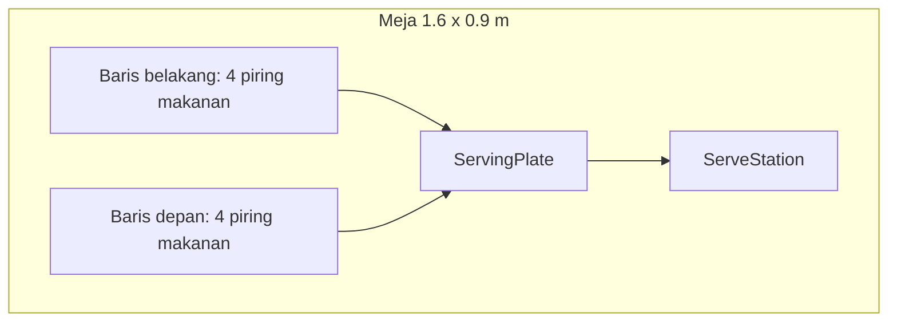

# Meja Serve: Hanya Makanan di Piring

Meja tempat `ServeStation` berada saat ini juga menampung `TableVase`, empat `TablePlant`, dua `Tray_*`, dan dua platter besar. Plan ini merapikannya menjadi **8 piring makanan individual** — satu piring atau mangkuk per tipe makanan — tanpa dekorasi meja. `ServeStation` dan `ServingPlate` tetap ada karena keduanya bagian dari aksi serve.

<Stat>
- Makanan: 8
- Piring makanan: 8
- Dekorasi meja: 0
- Serve station: 1
</Stat>

## Temuan meja saat ini

<Callout type="warn">
Objek non-makanan yang berada di area meja: `TableVase`, `TablePlant.001`–`TablePlant.004`, `Tray_Lauk`, `Tray_Karbo`, `LaukPlatter`, dan `KarboSayurPlatter`. Vase dan plant bahkan berada di tengah platter makanan.
</Callout>

## Layout baru

Posisi konsep:

| Baris | x | z | Isi |
|---|---|---|---|
| Belakang | -1.55, -1.15, -0.75, -0.35 | -1.30 | 4 piring makanan |
| Depan | -1.55, -1.15, -0.75, -0.35 | -1.05 | 4 piring makanan |
| Serving | -1.00 | -0.75 | piring saji |
| Station | -0.35 | -0.75 | tombol serve |

## Piring per tipe makanan

| Makanan | Wadah | Alasan |
|---|---|---|
| Rendang | `Bowl_Small` | berkuah/minyak |
| Burger | `Plate_Small` | kering |
| Telur rebus | `Plate_Small` | kering |
| Telur ceplok | `Plate_Small` | kering |
| Tempe | `Plate_Small` | kering |
| Brokoli | `Bowl_Small` | mudah terguling |
| Pisang | `Plate_Small` | kering |
| Mie goreng | `Bowl_Small` | berkuah/minyak |

## Rencana kerja

<Phase title="Audit meja" status="planned">
Kunci daftar objek yang boleh berada di atas meja.

- Whitelist: 8 `FoodPlate_<id>`, `ServingPlate`, `ServeStation`, dan makanan di dalamnya.
- Blacklist: `TableVase`, `TablePlant*`, `Tray_*`, `LaukPlatter`, `KarboSayurPlatter`.
- Catat bounds meja: x `-1.8..-0.2`, z `-1.55..-0.65`, top `0.755`.
</Phase>

<Phase title="Hapus dekorasi dan platter lama" status="planned">
Bersihkan meja sebelum menata ulang.

- `ShiftDiningFurniture`: nonaktifkan `TableVase` dan semua `TablePlant*`.
- Hapus `LaukPlatter`, `KarboSayurPlatter`, `Tray_Lauk`, `Tray_Karbo` dari scene.
- Jangan hapus `ServingPlate` atau `ServeStation`.
- Cek ulang tidak ada renderer dekorasi di atas meja.
</Phase>

<Phase title="8 food plate station" status="planned">
Ganti dua platter besar dengan satu station per makanan.

- `CreateFoodPlate`: plate/bowl + satu `FoodStand` + satu anchor + satu prefab makanan.
- `FoodStand.foods` berisi satu `FoodData`; `anchors` berisi satu transform.
- Food base di `y = 0.80`; plate base di `y = 0.755`.
- `FoodItem.SetHome` memakai world anchor; makanan tetap kinematic.
- `flow.stands` berisi 8 station.
</Phase>

<Phase title="Layout meja dan serve station" status="planned">
Pastikan 8 piring, piring saji, dan tombol tidak bertabrakan.

- 4 piring x 2 baris; plate radius 0.08 m; spacing x 0.4 m, z 0.25 m.
- `ServingPlate` di `(-1.0, 0.78, -0.75)`.
- `ServeStation` di `(-0.35, 0.78, -0.75)`.
- Tidak ada vase/plant/tray yang menembus piring.
- Reticle raycast tetap bisa mencapai semua makanan dari spawn.
</Phase>

<Phase title="UI, test, dan validator" status="planned">
Sesuaikan kode yang mengasumsikan dua platter.

- `Scene1HomeTests`: 2 stands → 8 stands; cek satu makanan per plate.
- `LevelSmokeTests`: batas tinggi makanan disesuaikan ke `y > 0.75`.
- `NutriPickSceneValidator`: 8 `FoodStand`, tidak ada `TableVase`/`TablePlant` di atas meja.
- Tambah `Scene1TableLayoutTests`: whitelist objek di area meja.
- `FoodCardGrid` tetap 8 kartu; tidak ada perubahan UI.
</Phase>

<Phase title="Visual QA dan build" status="planned">
Validasi hasil akhir dari atas dan dari sudut pemain.

- Capture top-down meja: hanya 8 piring makanan + piring saji + serve station.
- Capture first-person: makanan terlihat dan bisa dipilih.
- EditMode/PlayMode lulus.
- Build Windows sukses.
</Phase>

## File yang berubah

<FileTree>
- modify Assets/Editor/Scene1HomeBuilder.cs -- hapus platter/tray, tambah 8 food plate, matikan vase/plant
- modify Assets/Scenes/MainVR.unity -- layout meja baru
- modify Assets/Tests/PlayMode/Scene1HomeTests.cs -- 8 stands, satu makanan per plate
- modify Assets/Tests/PlayMode/LevelSmokeTests.cs -- batas tinggi makanan
- add Assets/Tests/PlayMode/Scene1TableLayoutTests.cs -- whitelist objek di meja
- modify Assets/Editor/NutriPickSceneValidator.cs -- validasi 8 stands dan meja bersih
- modify README.md -- dokumentasi layout meja
- modify specs/002-mainvr-food-service/quickstart.md -- QA meja
</FileTree>

## Keputusan desain

<Compare>
## 8 piring individual (pick)
- pro: satu tipe makanan = satu piring
- pro: meja mudah dipindai dan dibersihkan
- con: butuh 8 anchor dan layout lebih rapat

## 2 platter besar
- pro: sedikit draw call
- con: makanan tercampur dan dekorasi mudah menembus
- con: tidak memenuhi "per tipe objek makanan"

## 3 platter per kategori
- pro: pengelompokan protein/karbo/sayur
- con: masih ada makanan berbagi satu piring
</Compare>

<Callout type="decision">
Pakai **8 piring/mangkuk individual**. `ServeStation` dan `ServingPlate` tetap di meja karena keduanya adalah objek interaksi serve, bukan dekorasi. Semua vase, plant, tray, dan platter besar dihapus.
</Callout>

<Callout type="risk">
Meja 1.6 × 0.9 m cukup sempit. Plate radius 0.08 m dan spacing 0.4 × 0.25 m harus dicek dari top-down; jika bertabrakan, perkecil plate atau geser baris. Jangan menurunkan makanan di bawah `y = 0.75` agar reticle dan kamera tetap nyaman.
</Callout>

## Pertanyaan terbuka

<Questions>
- Berapa piring yang dipakai?
  - 8 piring individual (recommended)
  - 2 platter besar
  - 3 platter per kategori
- Apakah ServeStation dan ServingPlate tetap di meja?
  - Keduanya tetap (recommended)
  - Hanya ServeStation
  - Pindahkan ServingPlate ke meja lain
- Jenis wadah?
  - Bowl untuk berkuah, plate untuk kering (recommended)
  - Semua plate
  - Semua bowl
- Dekorasi meja?
  - Hapus vase, plant, dan tray (recommended)
  - Hapus plant saja
  - Pertahankan vase
</Questions>

## Selesai bila

<Checklist title="Definition of done">
- [ ] Tidak ada `TableVase`, `TablePlant*`, `Tray_*`, atau platter besar di atas meja
- [ ] Ada 8 piring/mangkuk, satu per tipe makanan
- [ ] `flow.stands` berisi 8 station
- [ ] `ServingPlate` dan `ServeStation` tetap berfungsi
- [ ] Reticle bisa memilih semua makanan
- [ ] Test top-down/whitelist lulus
- [ ] EditMode dan PlayMode lulus
- [ ] Build Windows sukses
</Checklist>
