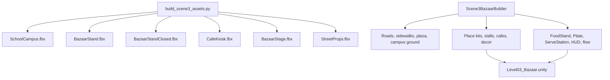

# Scene 3 — Flamboyant Bazaar District

Level 3 is a walkable late-afternoon bazaar on **Jl. Flamboyant**. The map screenshot fixes the macro layout: the street runs north–south on the west, **SMA Negeri 1 Manado** occupies the central-east block as a non-enterable backdrop, and **Jl. Pramuka 19** closes the south edge. Eight interactive stalls line both sides of Jl. Flamboyant, four closed stalls fill the background, two cafes with terraces sit on the west side, and a serving stage anchors the midpoint.

## Site sketch

```text
  WEST SIDE              JL. FLAMBOYANT            EAST SIDE / SCHOOL
  +-------------+                                   +----------------------+
  | KAFE KOPI   |                                   |  SMA NEGERI 1 MANADO |
  | terrace     |                                   |  [ closed gate ]     |
  +-------------+                                   |                      |
   [S1] Mie Goreng       |        [S2] Burger       |  main building       |
   [S3] Telur Rebus      |        [S4] Pisang       |  (2 floors)          |
                         |        [D3] closed       |                      |
   +------------------+  |                         |                      |
   |  PANGGUNG BAZAAR |  |                         |                      |
   |  [ serve table ] |  |                         |                      |
   +------------------+  |                         |                      |
                         |                         |                      |
   [S5] Tempe            |        [S6] Brokoli      |                      |
   [S7] Air Putih        |        [S8] Teh Manis    +----------------------+
                         |        [D4] closed
  +-------------+        |
  | KAFE BAKAR  |        |
  | terrace     |        |
  +-------------+        |
  =======================+============================================
   JL. PRAMUKA 19              [D1] closed      [D2] closed
                              SMK NEGERI 1 (backdrop) beyond
```

**Legend** — `[S#]` interactive stall · `[D#]` closed decorative stall · `==` road · stage is the serve point · school and SMK are non-enterable

<Stat>
- Playable footprint: 62 × 88 m
- Interactive stalls: 8 — 4 west + 4 east
- Decorative stalls: 4 — closed, no interaction
- Cafes: 2 with terraces — visual only
- Level timer: 180 s
</Stat>

## Layout

| Zone | X range | Z range | Notes |
|---|---|---|---|
| Jl. Flamboyant | -12..-6 | -44..+42 | 6 m pedestrian road |
| Central plaza | -16..-2 | -10..+10 | widened square |
| Panggung Bazaar | -11..-5 | -3..+3 | stage and serve counter |
| West interactive row | -16..-13 | +28, +18, -18, -28 | four stalls, face east |
| East interactive row | -5..-2 | +23, +13, -13, -23 | four stalls, face west |
| Kafe Kopi | -18..-10.5 | +30..+38 | terrace, visual only |
| Kafe Bakar | -18..-10.5 | -40..-32 | terrace, visual only |
| Decor stalls, Flamboyant | -5..-2 | +33, -33 | two closed stalls |
| Decor stalls, Pramuka | +8, +16 | -35.5 | two closed stalls |
| School backdrop | +2..+38 | -30..+30 | fenced, closed gate |
| Jl. Pramuka 19 | -18..+44 | -46..-40 | south edge |
| SMK backdrop | +6..+44 | -60..-48 | across Pramuka |

Player spawn: `(-9, 0, 41.5)` on the closed street, facing south. The serving plate and station sit on the stage counter at `(-8, 0.78, 2.35)`.

## Build pipeline



<Phase title="Blender kit" status="done">
- Six flat-shaded exports at 1 unit = 1 m.
- School facade, fence, closed gate, yard, flag, and trees.
- Open and closed bazaar stands, cafe with terrace, stage with canopy and counter.
- Street props include lamps, string lights, bollards, planters, banners, benches, scooters, and a perimeter tree line.
</Phase>

<Phase title="Scene assembly" status="done">
- `Scene3BazaarBuilder` creates a fresh `Level03_Bazaar.unity`.
- The builder keeps the FBX import rotation on the model child and applies placement to a wrapper, so every kit stays upright.
- Ground surfaces, curbs, crosswalks, campus ground, and invisible play-area boundaries are Unity primitives.
</Phase>

<Phase title="Gameplay wiring" status="done">
- Eight interactive `FoodStand` stations, one food each, at counter height.
- Four `DecorStall` markers with no `FoodStand` and no `FoodItem`.
- `ServingPlate` + `ServeStation` on the stage counter; `LevelFlowController` knows all eight stands.
- `FigmaHUD`, Status Makanan, and Final Result come from the existing prefabs; the level uses the existing 8-food pool and 180-second timer.
</Phase>

<Phase title="Verification" status="done">
- Validator passes for both `MainVR` and `Level03_Bazaar`.
- EditMode: **27/27 passed**.
- PlayMode: **14 passed, 1 skipped, 0 failed** — the skip is the missing `Level02_Padang` scene.
- Six Level 3 previews captured: spawn, west row, east row, stage, school, Pramuka, and top-down.
- No Windows player build was produced, per the approved scope.
</Phase>

<Callout type="decision">
**Eight interactive stalls plus four decorative ones.** Each interactive stall holds exactly one food. Decorative stalls use the closed model, carry a `TUTUP` sign, and never hold food, so they cannot be mistaken for serving points.
</Callout>

## Files

<FileTree>
- add Blender/Scene3_Bazaar/Scene3_Bazaar.blend -- kit source
- add Blender/Scene3_Bazaar/scripts/build_scene3_assets.py -- exports the six FBX kits
- add Assets/Models/Environment/Bazaar/SchoolCampus.fbx
- add Assets/Models/Environment/Bazaar/BazaarStand.fbx
- add Assets/Models/Environment/Bazaar/BazaarStandClosed.fbx
- add Assets/Models/Environment/Bazaar/CafeKiosk.fbx
- add Assets/Models/Environment/Bazaar/BazaarStage.fbx
- add Assets/Models/Environment/Bazaar/StreetProps.fbx
- add Assets/Materials/Bazaar/ -- URP palette and skybox
- add Assets/Scripts/Content/DecorStall.cs -- marker for closed stalls
- add Assets/Editor/Scene3BazaarBuilder.cs -- builds and saves the scene
- add Assets/Scenes/Level03_Bazaar.unity -- the level scene
- add Assets/Tests/PlayMode/Scene3BazaarTests.cs -- layout and flow checks
- delete Assets/Scenes/Scene 3.unity -- replaced by Level03_Bazaar
- modify Assets/Tests/PlayMode/LevelSmokeTests.cs -- eight-stand Level 3 smoke test
- modify Assets/Editor/NutriPickSceneValidator.cs -- Level 3 validation and previews
- modify ProjectSettings/EditorBuildSettings.asset -- add Level03_Bazaar
- modify README.md -- document Scene 3
- add specs/006-scene3-flamboyant-bazaar/plan.mdx -- this record
</FileTree>

## Notes

<Callout type="risk">
**The campaign path is still broken.** `LD_MainVR` points to `Level02_Padang`, and that scene is absent from the working tree. Scene 3 loads from Build Settings, but finishing Level 1 cannot reach it. This is intentionally out of scope.
</Callout>

<Callout type="note">
Cafes and decorative stalls are visual only. The school gate is closed, the fence and campus collider block entry, and the only serve point is the Panggung Bazaar counter.
</Callout>

<Checklist title="Acceptance criteria">
- [x] Scene loads from Build Settings and starts immediately
- [x] Eight interactive stalls, four on each side of Jl. Flamboyant
- [x] Four decorative stalls read as closed and never carry food
- [x] School reads as a backdrop; the player cannot enter the gate
- [x] Serving at Panggung Bazaar opens Final Result
- [x] Validator, EditMode, and PlayMode tests pass
- [x] No Windows player build produced in this scope
</Checklist>
