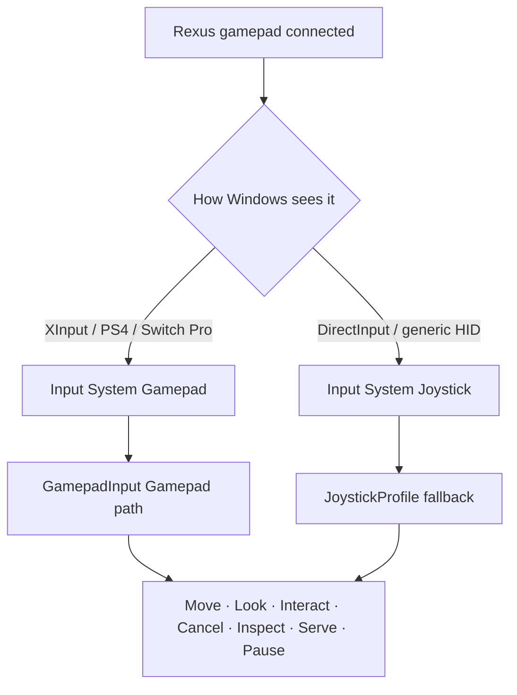

# Rexus Gamepad — Player Controller Support

The player reads the new Input System through `Gamepad.current` for XInput, DualShock, and Switch Pro-style pads. A Rexus pad in DirectInput or Android mode can appear as a generic `Joystick`, so this change adds a generic-joystick profile, a live diagnostic overlay, and input tests while keeping the existing keyboard/mouse fallback.

## Compatibility decision



## Controller map

```text
              REXUS GAMEPAD
   ┌──────────────────────────────────┐
   │  Left stick    → Move            │
   │  Right stick   → Look            │
   │  A / Cross     → Interact        │
   │  B / Circle    → Cancel          │
   │  X / Square    → Inspect         │
   │  Start/Options → Serve           │
   │  Select/Share  → Pause           │
   └──────────────────────────────────┘
```

| Action | Gamepad path | Generic joystick profile | Keyboard / mouse |
|---|---|---|---|
| Move | `leftStick` | `stick` | WASD |
| Look | `rightStick` | optional second stick or axes, else mouse | Mouse delta |
| Interact | `buttonSouth` | `button1` by default | Enter / left click |
| Cancel | `buttonEast` | `button2` by default | Right click |
| Inspect | `buttonWest` | `button3` by default | Tab |
| Serve | `start` | `button9` by default | Space |
| Pause | `select` | `button8` by default | Escape |

## Implementation

<Phase title="Diagnostics overlay" status="done">
- `ControllerDiagnostics` is on the `PlayerRig` prefab.
- Press `F9` in Play mode to list the active `Gamepad`/`Joystick` devices, layouts, live stick/button values, and to copy a report to the clipboard.
- The overlay is hidden by default.
</Phase>

<Phase title="Generic joystick profile" status="done">
- `Assets/Input/RexusJoystickProfile.asset` defines relative control paths.
- `JoystickProfile.Find` resolves relative paths such as `stick`, `stick/x`, `button1`, and `trigger`, with optional usage paths.
- `GamepadInput` prefers `Gamepad.current`, then the profile's `Joystick`, then keyboard/mouse.
- Stick deadzone and invert-Y are exposed on `GamepadInput`; move/look speeds remain on `FirstPersonController`.
</Phase>

<Phase title="Verification" status="done">
- EditMode: **27/27 passed**.
- PlayMode: **19 tests — 18 passed, 1 skipped, 0 failed**; the skip is the missing `Level02_Padang` scene.
- Four new `GamepadInputTests` cover virtual Gamepad movement/look/interact, generic Joystick movement/trigger, Gamepad priority, and keyboard fallback.
- The physical Rexus was not connected during verification; the F9 overlay and profile asset are ready for a device pass.
- No Windows player build was produced.
</Phase>

<Callout type="note">
If the Rexus appears as a `Joystick`, open `Assets/Input/RexusJoystickProfile.asset` and fill `lookStickPath` or `lookXPath`/`lookYPath` from the F9 report. If it appears as a `Gamepad`, the existing path needs no profile changes.
</Callout>

## Files

<FileTree>
- modify Assets/Scripts/Player/GamepadInput.cs -- Gamepad + generic Joystick + keyboard/mouse
- add Assets/Scripts/Player/JoystickProfile.cs -- relative control paths and device resolution
- add Assets/Scripts/Player/ControllerDiagnostics.cs -- F9 device/layout overlay
- modify Assets/Scripts/Player/FirstPersonController.cs -- exposed movement and look ranges
- add Assets/Input/RexusJoystickProfile.asset -- default generic mapping
- modify Assets/Prefabs/Player/PlayerRig.prefab -- add diagnostics and assign the profile
- add Assets/Tests/PlayMode/GamepadInputTests.cs -- virtual device coverage
- modify Assets/Tests/PlayMode/NutriPick.Tests.PlayMode.asmdef -- Input System test references
- modify README.md -- Rexus modes and F9 diagnostics
- add specs/007-rexus-gamepad/plan.mdx -- this record
</FileTree>

## Done when

<Checklist title="Acceptance criteria">
- [x] Gamepad path still drives move, look, and all actions
- [x] Generic joystick profile drives move and buttons
- [x] Gamepad takes priority when both devices exist
- [x] Keyboard/mouse fallback still works
- [x] F9 diagnostics overlay is available
- [x] EditMode and PlayMode suites pass
- [x] No Windows player build produced in this scope
- [ ] Physical Rexus device pass confirms the detected layout
</Checklist>
